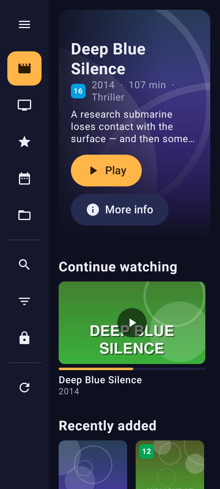
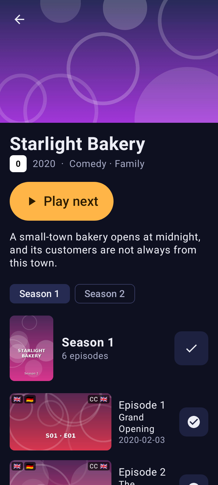
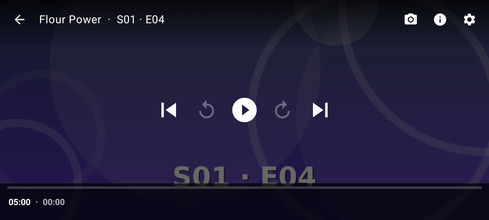
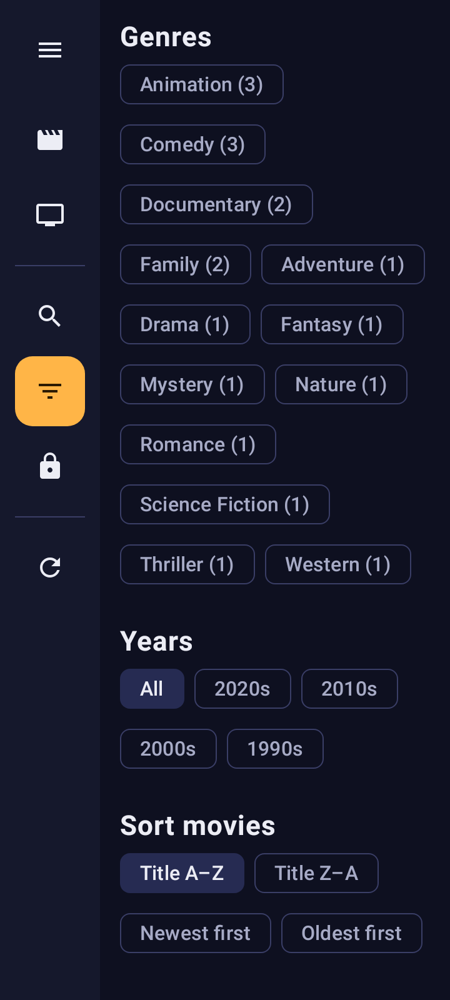
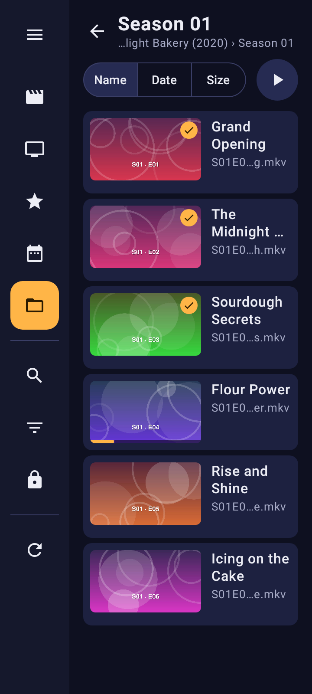

# MediaDroid

[](https://github.com/Hawkynt/MediaDroid/blob/main/LICENSE)
[](https://github.com/Hawkynt/MediaDroid)

[](https://github.com/Hawkynt/MediaDroid/actions/workflows/ci.yml)


[](https://github.com/Hawkynt/MediaDroid/stargazers)
[](https://github.com/Hawkynt/MediaDroid/network/members)
[](https://github.com/Hawkynt/MediaDroid/issues)


[](https://github.com/Hawkynt/MediaDroid/releases/latest)
[](https://github.com/Hawkynt/MediaDroid/releases)
[](https://github.com/Hawkynt/MediaDroid/releases)

> Your movies and shows are already organized — folders with `.nfo` files and cover art, scraped by Kodi or MediaBrowser over the years. MediaDroid plays that library straight from where it lives — local storage, a NAS share, an FTP server or a cloud folder — on an Android box, tablet or phone, or a Windows or Linux PC: no media server, no account of ours, no re-scraping, no re-encoding. It reads what is already there and turns it into a browse-and-play app simple enough for a six-year-old and a grandparent.



## 🧭 Vision

Media libraries on Android are usually either a raw file browser or a client of someone else's server. MediaDroid claims the middle ground that home media collectors actually live in: the folders are the library, and the `.nfo` sidecars and `folder.jpg` covers you already scraped are the metadata — no database of ours in between. The bar for success is a household where nobody has to be taught the app: a kid finds a film by its picture, a grandparent resumes a show where they left off, and everything answers instantly even on cheap hardware. The parser, the scanner, the search and the binge logic are pure and tested; the screens sit on top of them and must never get slower than the hardware allows. The app scans a library, shows the wall, plays with resume and binge auto-advance, decodes exotic audio through a bundled FFmpeg extension, and paints missing art from the video files themselves. The same app comes to Windows and Linux: the library, the sources, the picture stage and the neural networks are shared, the screens are one Compose UI, and a desktop graphics card runs the heavy networks a phone has to refuse.

## ✨ Features

Every area in short with its sources linked; each fold-out (▸) holds the exact behaviour — this README is the app's
specification.

### 📚 Library

| | |
| --- | --- |
| Metadata | `movie.nfo`, `tvshow.nfo`, `season.nfo` and episode NFOs, as [Kodi writes them](https://kodi.wiki/view/NFO_files); the file's own tags where there is none |
| Art | `folder.jpg`, `poster.jpg`, `fanart.jpg`, banners, logos, thumbs — [Kodi's artwork names](https://kodi.wiki/view/Artwork); missing art painted from a still of the video |
| Shows | `Season NN` folders or, without them, `SxxExx`, `NxNN`, `E03` / `EP003` and numbered folders |
| Movies | every other video; release clutter stripped from names; multi-part [stacking](https://kodi.wiki/view/Advancedsettings.xml#moviestacking); the same film twice is one card |
| Formats | every container Media3 or the bundled FFmpeg reads — see the [support matrix](#-support-matrix) |
| Sources | the device, SD and USB, SMB 2/3, NFS, FTP/FTPS, SFTP, WebDAV and every cloud with an Android document provider |
| Kept | no database: the folders are the library; only watched marks, resume points and a cache of each source's scan |

<details>
<summary>The library in detail</summary>

- Reads `movie.nfo`, `tvshow.nfo`, and per-episode NFOs: plot, cast, runtime, rating, sets, trailer links.
- Covers from `folder.jpg` / `poster.jpg`, backdrops from `fanart.jpg`, logos and banners where present. A movie file's own `<name>.jpg` or `<name>-poster.jpg` is its poster; a season's cover is the `folder.jpg` in its folder or `seasonNN-poster.jpg` beside the show; episodes show their `<name>-thumb.jpg`.
- No art? The app pulls a still out of the video itself — episode thumbs and poster fallbacks, generated once and cached on device; from files Android cannot read itself (DV, RealMedia, WMV and the other containers the bundled FFmpeg demuxes) through FFmpeg. A show without a cover or backdrop is pictured by the first episode of its first regular season (never the specials), a season without a cover by its first episode's thumb or a still from it — on the wall and on the details screen alike.
- Shows without `Season NN` folders are grouped into virtual seasons from `SxxExx` / `NxNN` file names; titles fall back to the folder and file names. Absolute numbering without seasons — `E3`, `E03`, `EP003`, common for anime — is season 1, and inside a `Season NN` folder a bare `E03` belongs to that season. A folder whose videos all carry a number after the same name is a show too: zero-padded numbers (`sr.01.title`) are absolute episodes of season 1, three or four digits are season and episode the way Kodi reads them (`Show 101 - Title` is S01E01), and numbered names that extend the series' name (`sr.le.1.title`) are specials. The whole folder has to agree, so a numbered movie (`Blade Runner 2049`, `Rocky 2`, `Heat cd01`) stays a movie.
- Release clutter in movie and show names is stripped: `The.Big.Short.2015.German.DL.1080p.BluRay.x264-GRP` reads `The Big Short (2015)`. Episodes are labelled `Episode 3`; a title comes from the episode NFO, or from the file name only in the clean forms `S01E03 - Title`, `1x03 - Title`, `E03 - Title` or `EP003 - Title`. Anything else stays `Episode 3` — rename the file or add an NFO to give it a title. An NFO title always wins.
- A movie without an NFO title takes the title stored inside the file (Matroska `Title`, MP4 `©nam`) before its cleaned-up file or folder name.
- Every video that is no episode is a movie, even without a year or an NFO (`Heat.mp4` is `Heat`); a folder holding one video is that movie, named after the folder. Trailers (`<name>-trailer.mkv`) and samples are skipped.
- Art in any picture format: JPEG, PNG, WebP, GIF, BMP, HEIC/HEIF and AVIF through Android's own decoders, TIFF (strips or tiles; LZW, Deflate or PackBits), TGA and PCX through the app's own — large scans are sampled down to the screen as they are read.
- Every container the player reads counts as a video: MP4 and QuickTime (`.mp4 .m4v .mov .qt .3gp .3g2 .f4v`), Matroska and WebM (`.mkv .mk3d .webm`), AVI (`.avi .divx .xvid`), MPEG program streams (`.mpg .mpeg .mpe .mp2 .m2p .vob`, and the camcorder and DVD-recorder `.mod .tod .vro`), MPEG transport streams (`.ts .m2ts .mts .m2t .tp .trp`), Ogg (`.ogv .ogm .ogx`) and Flash video (`.flv`) through Media3's own readers; and through the bundled FFmpeg's demuxers, for what Media3 cannot read, MPEG-1 system streams (the older `.mpg` and `.mpeg`, also with MPEG-2 video — never mistaken for an MP3 for their MPEG sound), Windows Media (`.wmv .asf .wtv .dvr-ms`), RealMedia (`.rm .rmvb`), DV (`.dv .dif`), NUT, MXF, NuppelVideo (`.nuv`), raw MPEG video, H.264 and HEVC streams (`.m2v .mpv .264 .h264 .265 .h265 .hevc`), Y4M and IVF.
- Multi-part movies (`CD1`/`CD2`, `part1`/`part2`, `disc a`/`disc b`, as Kodi stacks them) are one movie that plays its parts one after the other, with the folder's cover.
- From NFOs: genres, an age badge in the familiar rating colours, and flags for the audio and subtitle languages listed in the stream details.
- Settings list every source the library is read from, each with its own name: the media folder chosen at the start, further folders on the device, Windows / Samba shares (SMB 2/3, with user and password or as guest; servers announcing themselves on the local network are offered with one tap), NFS exports (NFSv3, by export path and user id; the export must allow connections from non-privileged ports, as an app cannot use the privileged ones), FTP and FTPS (passive mode) SFTP (password or SSH key; the server's host key is kept on first use and a changed one refused) WebDAV folders — Nextcloud, ownCloud, NAS web shares — by their address, user and password, each tested before saving; and cloud folders — Google Drive, OneDrive, Dropbox, Nextcloud and anything else that installs an Android document provider — picked in the system's own folder picker like a local folder, so the app itself stores no cloud password. Each source's scan is kept on the device: the walls appear at once on start and offline, and a rescan reads again only the NFOs and EDLs that changed (by size and modification time). A source that cannot be reached keeps its titles on the walls, greyed out with "not reachable right now". Videos on a source stream with up to two minutes buffered ahead, so 4K over Wi-Fi rides out the dips; resume, binge, intro and credit skipping (chapters and EDLs), badges and thumbnails work as for local files, and frames and badges are probed once and cached. The walls merge them — a film found on two sources is one card with both files — and videos on a share stream straight from it, with their posters and thumbs fetched once and kept small on the device. Passwords live encrypted under a key in the Android Keystore, never in the state file; a source that cannot be reached shows as "not reachable right now" in Settings.
- No database: the folders are the library. It is re-read every time the app opens or comes back to the foreground, so a film copied onto the SD card is simply there. Watched marks and resume positions are the only things the app keeps. Coming back from a title's details lands at the same scroll position.
- Local libraries work fully offline. No account of ours and no telemetry; a network share or cloud is contacted only once you add it as a source, with the credentials you give it, kept in the device's keystore.

</details>

### 🧭 Browsing

- A sidebar for Movies, TV Shows, Genres, Years, Files, Search, Filters and Settings; each section's home reads like a
  streaming app — a hero, *Continue watching*, more rows, the poster wall.
- Walls as posters, a compact list or a details list; sorting, filters, decades, facet counts and an A–Z rail.
- Badges probed from the file itself: resolution, HDR, video format, audio format and channels, language flags.
- A Files browser showing storage as it really is, NFOs and art still counted.
- Touch, mouse and TV remote alike; big targets and high contrast.

<details>
<summary>Browsing in detail</summary>

- The bottom of the sidebar shows the last thing played — its picture, title, episode and how far in — and one tap resumes it from any screen; collapsed, it is a play button over the picture.
- A sidebar on the left switches between Movies and TV Shows (plus Search, Filters and Settings); the content side shows only that selection. One tap collapses it to an icon rail and expands it again, and it remembers how you left it.
- The home of each section reads like the streaming apps everyone already knows: a backdrop hero for one title with Play and More info, a Continue watching row, then the poster wall. Works with touch, a mouse, or a TV remote's D-pad.
- The media folder is chosen with Android's own folder picker — internal storage, SD card or USB drive — with a typed path as the fallback for boxes that ship no picker.
- A title's details open with its backdrop across the top, never taller than 40 % of the screen, so the title, Play and the start of the plot are in view in portrait and landscape alike.
- A long press on any poster or file — or holding a remote's OK — tells what it is about without opening it: the title, year, length and genres, the description, director, cast, studio and rating, and whether that comes from the NFO or the file's own tags.
- Episode previews carry what the file holds: audio-language flags, subtitle languages, and badges for resolution (480p … 2K, 4K, 8K), HDR (HDR10, HDR10+, Dolby Vision, HLG), the video format and the best audio (Dolby Digital/Digital+/TrueHD/Atmos, DTS/DTS-HD MA/DTS:X, …) with its channels. They are read out of the video itself once and cached; the NFO's stream details only stand in when a file cannot be read. File names are never trusted for it.
- Watched ticks: every movie, every episode and every whole season has one, and the wall marks a movie or a show once all of it is watched; tapping it marks watched or unwatched, and that choice wins over a playcount in the NFO.
- Instant search across the whole library.
- Three ways to lay out a wall, switched at its head and remembered: posters, a compact list (small poster, title, year and runtime or seasons, genres, age badge and the quality badges probed from the file) and a details list that adds two lines of plot — for remotes and for libraries too big to scan by pictures.
- Every poster and list row — on the walls and in search — carries the watched tick and, while something is under way, a resume bar along its picture: the movie part or the show's episode with a resume point.
- More rows under Continue watching: *Recently added* (the NFO's `<dateadded>`, else the file's date on disk, newest first), *Not watched yet* and, for shows, *New episodes* (shows whose newest episode is unwatched, newest first). Each scrolls sideways and ends in *See all*, which opens the whole row as a wall; Back returns to the home.
- Walls of 30 titles or more in title order get an A–Z rail along the edge; touching or dragging along it jumps to the letter (accents fold in, `Ä` is `A`; digits are `#`), and the letter shows big while dragging.
- The same film found more than once — the same title and year, say 1080p and 4K, or two language cuts — is one card with a small file count. Its details list every file with its resolution, HDR, audio and language badges and size, each one tap from playing; Play takes the one with a resume point, else the best picture (resolution, then HDR, then the bigger file), and a watched mark on any of them counts for the film.
- Filter by genre and year, group by decade, facet counts as you browse.
- A film's details add, where the NFO has them, the rating, release date, director and studio; a *Trailer* button when a `<name>-trailer.*` sits beside it (trailers stay off the wall); and descriptions for the show, each season (its `season.nfo`) and each episode, under the play button; and a *File* section, folded away until opened, with the path, size, container and every video, audio and subtitle track named by the codec the file holds it in, with its profile and level where the file says (`H.264 · High@L4.1`, `HEVC · Main 10@L5.1`, `AAC · HE-AAC`) — what is in the file, not what plays it.
- A Files entry in the sidebar browses storage as it really is, like a file manager: the internal storage, SD cards and USB drives, not only the media library. Nothing is renamed or grouped — folders and files keep their real names — but what sits beside them counts: a video's NFO gives it its title, plot, age badge and watched state, `folder.jpg` / `poster.*` is a folder's cover and `<name>.jpg`, `<name>-poster.*` or `<name>-thumb.*` a video's picture, falling back to a frame from the video. Without an NFO, the title and description the file carries itself (Matroska's segment title, MP4's name and description atoms) name and describe it. Folders come first, then videos with their picture, duration, size and quality badges, sorted by name (as numbers read, `2` before `10`), date or size. Tapping a video plays it with resume; binge mode goes on to the next video in the folder in that order, and Play on a folder starts with its first. Every saved network and cloud source is listed beside the volumes and browsed the same way.
- Genres and Years are places in the sidebar too: a list of genres or decades with their counts and a strip of posters each, for Movies or TV Shows; tapping one opens that wall narrowed to it, with *Clear filters* to get back.
- Sort each wall its own way, remembered per section: title A–Z or Z–A, newest or oldest, recently added (the NFO's `<dateadded>`, else the file's time), runtime shortest or longest first and, where NFOs carry it, best rated; TV shows add recently updated, the show with the newest episode first.
- Dark cinema theme and its own launcher icon, adaptive and themed-icon ready.
- Big touch targets and high contrast — usable by kids and older users without glasses-or-guessing.

</details>

### ▶️ Playback

- Resume everywhere, binge mode on, intros skipped and credits ending an episode — from the file's chapters or an
  [edit decision list](https://kodi.wiki/view/Edit_decision_list) beside it.
- The device's hardware decoders first; the bundled [FFmpeg](https://ffmpeg.org/) decoders
  ([Media3 FFmpeg extension](https://github.com/androidx/media/tree/1.11.1/libraries/decoder_ffmpeg)) for
  everything else — WMV, VC-1, RealVideo, DV, AC3, DTS, TrueHD and more.
- Speed 0.2×–5×, held skips that grow, sleep timer, repeat, rotation, picture in picture, media keys everywhere.
- The file's chapters listed and jumped to, one frame forward and back while paused, and a part repeated between two
  marks.
- Even frames: the speed nudged so every frame stays on screen equally long where the screen cannot switch its rate.
- Snapshot: the camera button saves the picture on screen — filters and all — as a PNG in Pictures, ready to share.

<details>
<summary>Playback in detail</summary>

- Resume: every item remembers where you stopped — once it has played for three minutes (half of a shorter clip), so a look of some seconds into an episode leaves nothing to continue; a point already under way moves on with every stretch. Once only the last two minutes or the credits are left — played up to there or skipped forward into them — the item counts as watched. Play on a show carries on with the first episode not yet marked watched, from its resume point if it has one — a watched episode's leftover point is no reason to go back to it; Continue watching shows the season and episode and a bar of how much is watched, leaves out what is watched already, and a card held offers "Remove from Continue watching", which forgets that point.
- Binge mode, on out of the box: when an episode ends, the next one starts — season by season, in order. Intros are jumped over (also those after a cold open) and an episode ends where its credits begin, when the file's own chapters (Matroska / WebM, MP4 / MOV — Nero or QuickTime — and Ogg) or an edit decision list beside it mark them — the Kodi / MPlayer `.edl` that Jellyfin's Intro Skipper, Comskip and friends write (`<video>.edl`: `start end action` per line; a cut, commercial break or intro edit near the start is the intro, the last one after it is where the credits begin). Both can be switched off in Settings.
- Holding skip forward or back — on screen, or a remote's left/right and its rewind / fast-forward keys — steps 10 s, then 30 s after three seconds of holding, 60 s after six and five minutes after nine; the target time shows while holding and letting go seeks there once. A short tap stays the ordinary skip.
- Seek-bar thumbnails: dragging along the seek bar — or stepping along it with a remote — shows a picture of the moment under the finger above it, with its time, taken from the file itself (local or on any source; Android's own reader, the bundled FFmpeg for what it cannot read). The timeline is cut into at most 300 steps of whole seconds (2 s to 1 min each), one picture per step from the keyframe nearest its middle; the file is opened once per video, the pictures are taken one at a time on a background thread so playback keeps its pace, a picture the finger has already passed is never taken, and a picture kept for a nearby step stands in while the right one loads. Pictures are kept in memory and in a small cache on the device (32 MB, the longest unused going first), so seeking the same film again is instant.
- Picture in picture: leaving the app while a film plays on the phone shrinks it into a small window in the picture's own shape; tapping it brings the full player back where it was. Leaving while paused — or closing the small window — pauses the film instead of letting it play on unseen.
- Browsing while it plays: Back in the player shrinks it into the sidebar's corner, where the resume card sits, and the menus are free — the film plays on there, and on a second screen it plays on full size while the phone shows its picture in the corner. A tap on the corner brings the full player back where it was, its cross ends it, and the end of the queue ends it by itself.
- Media controls everywhere: play/pause, next and previous work from headset and Bluetooth buttons, the media notification and the lock screen while the player is open; next and previous follow the episodes or the parts of a movie. Android 13+ asks once for the notification.
- Snapshot: the camera button in the player's top bar saves the picture as it is on screen — every filter applied, at the size it is shown, read back from the picture stage — as a lossless PNG named after the title and the moment (`Title 01-23-45.png`) in the system's Pictures collection, in a MediaDroid album; the picture shows small for a few seconds with a button to share it. Where the stage stands aside (no filter set, HDR on a screen that shows it) the view's own picture is copied, and failing that the frame at that moment is decoded afresh. From Android 10 no permission is needed; before it, the storage permission is asked for once. A name already taken gets a number, nothing is overwritten.
- Rotation in the gear: auto, landscape or portrait, held for the session; leaving the player hands rotation back to the system.
- Sleep timer in the gear: off, 15, 30, 45, 60 or 90 minutes, or at the end of this video. While it runs the top bar shows the minutes left; when it runs out the sound fades over ten seconds and playback pauses. It never carries over to the next start.
- Repeat in the gear: off, this video, or all of it (the show or the folder, round again from the start) — for the film a child wants to see again and again. It lasts for the session.
- Repeat a part, in the top bar: one press marks where the part starts, the next where it ends, and from then on reaching the end jumps back to the start — for a song, a dance or a goal — until the third press. Intros and credits are not skipped meanwhile; the next video starts without it. On a keyboard L does the same, as in mpv.
- Chapters: where the file has its own (Matroska / WebM, MP4 / MOV, Ogg), the top bar lists them with where each begins, the one playing in bold, and a tap plays from there; the time bar marks where each begins. Page Up and Page Down go to the next and the previous chapter — a few seconds into one, the previous goes back to its start first, as in mpv.
- One frame at a time: while paused, the arrows in the top bar step one frame forward or back (and so do the media step keys, `.` and `,`). The step follows the video's frame rate, film's where the file does not say it.
- With the controls up, the bar also tells when the film will be over on the clock ("Ends 21:35", in the device's 12/24-hour format), allowing for the playback speed.
- The player shows nothing but the picture: a tap brings the controls up, a few seconds untouched fade them out, and the status and navigation bars stay hidden while watching.
- Video plays on the device's own hardware decoders; the bundled FFmpeg decoders only step in for what they cannot play — WMV, VC-1, RealVideo, DV, MS-MPEG4 and whatever a device lacks — in software, their pictures handed to the graphics chip as YUV planes, so they keep their full frame rate. Settings can put software decoding first, with a warning: it drains the battery fast and is meant for videos that otherwise do not play at all or only with errors.
- The file is read up to two minutes ahead, as far as a quarter of the app's memory holds — so even a file of raw, uncompressed 4K pictures plays rather than running the app out of memory.
- Decoded pictures kept ahead, in Settings: as seconds, MB or frames — whichever is chosen, the other two are shown beside it for a 1080p film at 25 fps — five seconds by default, at most a quarter of the device's memory. The bundled FFmpeg's decoder keeps at most 16 of them ready — as many as Media3's decoder renderer copes with, and no more than a quarter of the app's memory holds, five for 4K — and its pictures are drawn on whole screen refreshes; the device's own decoders keep their own few.
- Touch on the bare picture: double tap left or right jumps 15 s back or ahead, a vertical swipe on the left half sets the screen brightness and on the right half the volume — both run on past the device's maximum up to 800 %, doubling every third of the extra stretch: louder through the app's loudness gain (soft-saturating, so quiet tracks come up without cracking peaks), brighter through a gamma lift, the level then showing in the accent colour; swipes starting at the screen's edges and corners stay with Android's own gestures — and a pinch zooms up to 4× and pans the zoomed picture. The seek bar takes touches well above and below its line.
- Next and Previous on the controls move through the episodes or the parts of a movie; Previous restarts the current one when it is more than 3 s in.
- Turning the device keeps the player going: same video, same position, same open panel.
- Even frames, in Settings: where the screen cannot switch to the film's frame rate, the film plays a little faster or slower so every frame stays on screen equally long — 23.976 fps as 24 on 120 Hz, 25 fps as 30 or 20 on 60 Hz — slight (up to 5 %) or strong (up to 25 %), towards the nearest rate, only faster or only slower; the sound keeps its pitch. What counts is the film's rate times the chosen speed, worked out again whenever the speed changes, and together with matching the refresh rate the display mode needing the least change is chosen. Where nothing is within reach — 23.976 or 25 fps at 1.75× is about 42–44 pictures a second, between the 60 and 30 a 60 Hz screen shows evenly — the picture runs at the screen's rate with in-betweens blended by the time between the two frames (Smooth motion's High), the speed as chosen, unless the video has smooth motion of its own.

</details>

### 🎨 Picture

Every choice below is **tried on the device before it is taken**: a dry run of the real picture stage, 576p at
25 frames a second, has to keep within 80 % of a frame's time — or the choice is refused, saying what the device took,
and the one before stays. A neural network first passes a self-test of its own (right, and fast enough) in a process
of its own, within two seconds of the tap. All of it runs on the graphics chip between decoder and screen.

**Deinterlacing**

| Choice | What it does | From |
| --- | --- | --- |
| Auto | rebuilds lines only where the picture combs | — |
| Blend, Bob | both fields mixed / one field doubled | — |
| YADIF, BWDIF | the frames before and after weighed; optionally every field as a picture (50/60 a second) | FFmpeg's [yadif](https://github.com/FFmpeg/FFmpeg/blob/master/libavfilter/vf_yadif.c), [bwdif](https://github.com/FFmpeg/FFmpeg/blob/master/libavfilter/vf_bwdif.c) — byte for byte, on the GPU too ([check](tools/shader-check)) |
| Greedy HM, Greedy 2F | each line from the nearer field, diagonals smoothed / woven where nothing moved over two frames; every field too | [DScaler](https://github.com/JohnAdders/DScaler)'s: Greedy High Motion from [GStreamer](https://gstreamer.freedesktop.org)'s `greedyh`, Greedy 2-Frame rewritten from its behaviour — byte for byte, on the GPU too ([check](tools/shader-check)) |
| TomsMoComp | motion-compensated: each missing pixel from the best-agreeing pair along the motion in the fields either side, else an edge-directed bob; every field too | Tom Barry's, converted from [GStreamer](https://gstreamer.freedesktop.org)'s `tomsmocomp` — byte for byte with its search, on the GPU too ([check](tools/shader-check)) |
| MC Smooth | after QTGMC: every field BWDIF'd, averaged with the fields either side along the motion (a search up to 3 pixels across and 2 down), contra-sharpened, repaired to BWDIF's range, the camera's lines kept; the heaviest — most phones refuse it in the dry run | written from QTGMC's method; held to ground truth: progressive pictures split into fields come out nearer the originals than BWDIF's (up to 16 % less error on a pan, 12 % with noise) |
| Adaptive | woven whole while the picture stands still (100 still fields), BWDIF as soon as it moves | DScaler's Adaptive, rewritten from its behaviour |
| Old console | 240p games: each field its own picture, stretched smoothly, a still one averaged with the one before | DScaler's Old Game, rewritten from its behaviour; the stretch within 1/255 of FFmpeg's bilinear [scale](https://ffmpeg.org/ffmpeg-filters.html#scale) ([check](tools/shader-check)) |
| Film | 3:2 pulldown undone: the film's own 24 frames; at 25 a second 2:2 film woven back whole, video deinterlaced | FFmpeg's [fieldmatch](https://github.com/FFmpeg/FFmpeg/blob/master/libavfilter/vf_fieldmatch.c) and [decimate](https://github.com/FFmpeg/FFmpeg/blob/master/libavfilter/vf_decimate.c); for 2:2 [DScaler](https://github.com/JohnAdders/DScaler)'s PAL film detection, rewritten from its behaviour |

**Upscaling** — a strength slider blends each into plain scaling

| Choice | Kind | From |
| --- | --- | --- |
| Lanczos | Lanczos-3 filter | its kernel within 1/255 of [libplacebo](https://code.videolan.org/videolan/libplacebo)'s ([check](tools/shader-check)) |
| FSR | edge-adaptive upscaling and sharpening | [AMD FidelityFX Super Resolution 1](https://github.com/GPUOpen-Effects/FidelityFX-FSR) — RCAS bit for bit, EASU within 1/255 ([check](tools/shader-check)) |
| EWA | a sharpened Jinc over a circle | [libplacebo](https://code.videolan.org/videolan/libplacebo)'s EWA Lanczos-sharp — kernel within 2/255 of libplacebo ([check](tools/shader-check)) |
| NIS | directional filters and luma sharpening | [NVIDIA Image Scaling](https://github.com/NVIDIAGameWorks/NVIDIAImageScaling) — within 1/255 ([check](tools/shader-check)) |
| GSR | one pass, edge-directed, any ratio | [Snapdragon Game Super Resolution 1](https://github.com/quic/snapdragon-gsr) — bit for bit ([check](tools/shader-check)) |
| Anime4K | a small network for line art, 2× | [bloc97/Anime4K](https://github.com/bloc97/Anime4K) — within 1/255 of libplacebo ([check](tools/shader-check)) |
| ACNet | a small network on the luma, for anime, 2× | [TianZerL/ACNetGLSL](https://github.com/TianZerL/ACNetGLSL) (F8B4), from [Anime4KCPP](https://github.com/TianZerL/Anime4KCPP) — within 1/255 of libplacebo ([check](tools/shader-check)) |
| xBRZ | rules for pixel art and cartoons, 2–6× | [Zenju's xBRZ](https://sourceforge.net/projects/xbrz/) — pixel for pixel, on the GPU too ([check](tools/shader-check)) |
| Real-ESRGAN | neural, 4×, in tiles (TFLite: NPU, GPU or CPU; on the desktop ncnn, the compact video model or the general x4plus, fetched, 33 MB) | [xinntao/Real-ESRGAN](https://github.com/xinntao/Real-ESRGAN), [Qualcomm's export](https://huggingface.co/qualcomm/Real-ESRGAN-General-x4v3) |
| waifu2x | neural CUnet for drawings, 2× (ncnn); noise removal off or 0–3, eight ways on request | [nagadomi/waifu2x](https://github.com/nagadomi/waifu2x) via [waifu2x-ncnn-vulkan](https://github.com/nihui/waifu2x-ncnn-vulkan) |
| Real-CUGAN | neural, for anime, 2×, 3× or 4× (ncnn); conservative, no denoise or denoise 1–3, the pro models, eight ways on request | [bilibili's Real-CUGAN](https://github.com/bilibili/ailab/tree/main/Real-CUGAN) via [realcugan-ncnn-vulkan](https://github.com/nihui/realcugan-ncnn-vulkan) |
| RealSR | neural, for photos and film, 4×; fetched, 33 MB | [jixiaozhong/RealSR](https://github.com/jixiaozhong/RealSR) via [realsr-ncnn-vulkan](https://github.com/nihui/realsr-ncnn-vulkan) — [files](https://huggingface.co/Hawkynt/mediadroid-models/tree/main/realsr) |

**Smooth motion** — the pictures between two frames

| Choice | How | From |
| --- | --- | --- |
| Low, Medium, High | the two frames blended by the time between them | — |
| Motion | built along block motion | FFmpeg's [minterpolate](https://github.com/FFmpeg/FFmpeg/blob/master/libavfilter/vf_minterpolate.c) — byte for byte |
| RIFE | neural, at any size (ncnn), carried in the app | [Practical-RIFE](https://github.com/hzwer/Practical-RIFE) 4.25 lite via [rife-ncnn-vulkan](https://github.com/TNTwise/rife-ncnn-vulkan) |
| DAIN | neural, weighing depth; fetched, 51 MB | [baowenbo/DAIN](https://github.com/baowenbo/DAIN) via [dain-ncnn-vulkan](https://github.com/nihui/dain-ncnn-vulkan) — [files](https://huggingface.co/Hawkynt/mediadroid-models/tree/main/dain) |
| XVFI | neural, coarse to fine; fetched, 11 MB; research and education only | [JihyongOh/XVFI](https://github.com/JihyongOh/XVFI) — [files](https://huggingface.co/Hawkynt/mediadroid-models/tree/main/xvfi), [conversion](tools/xvfi/README.md) |
| FLAVR | neural, four frames at once; fetched, 84 MB | [tarun005/FLAVR](https://github.com/tarun005/FLAVR) — [files](https://huggingface.co/Hawkynt/mediadroid-models/tree/main/flavr), [conversion](tools/flavr/README.md) |
| CAIN | neural, channel attention, no flow; fetched, 86 MB | [myungsub/CAIN](https://github.com/myungsub/CAIN) via [cain-ncnn-vulkan](https://github.com/nihui/cain-ncnn-vulkan) — [files](https://huggingface.co/Hawkynt/mediadroid-models/tree/main/cain) |
| IFRNet | neural, flows and features in one pass; light, carried in the app | [ltkong218/IFRNet](https://github.com/ltkong218/IFRNet) (S model) via [ifrnet-ncnn-vulkan](https://github.com/nihui/ifrnet-ncnn-vulkan) |

**Debanding** — the 8-bit steps in a sky or a fade to black smoothed away rather than hidden under grain:
[libplacebo](https://code.videolan.org/videolan/libplacebo)'s deband (mpv's `--deband`), one slider from off through
libplacebo's own defaults to four iterations — within 1/255 of libplacebo on GLSL ES 3 chips ([check](tools/shader-check)).

**Colour edges** — a 4:2:0 video carries a quarter as many colour samples as pixels; how they are spread decides
whether a red coat ends at its edge or bleeds past it. Bilinear blends the nearest four, Spline36 weighs six by six
(libplacebo's `spline36`, mpv's `--cscale=spline36`), and KrigBilateral (Shiandow's mpv shader) lets the colour follow
the brightness's own edges. For pictures the app decodes itself — the bundled FFmpeg on Android, everything on the
desktop; a device's own decoder hands over RGB its driver already made. Within a step or two of libplacebo running both
([check](tools/shader-check)).
**Station logos** — a channel's logo or burned-in bug hidden in the corner picked once per show and remembered for its
folder: filled in from the picture around it (agreeing with FFmpeg's delogo, [check](tools/shader-check)), greyed, or
held no brighter than its surroundings so its glow goes and the picture under it stays.
**Deblocking and deringing** — what a starved MPEG encoder leaves: the 8 × 8 blocks smoothed away where the step at
their edge is small and the pixels beside it flat (FFmpeg's `deblock`, weak then strong, its own thresholds in the
middle of the slider), and the ripples beside edges and text smoothed along the edge (AV1's CDEF, as dav1d runs it) —
both on the picture's own block grid, before every other filter; byte for byte with FFmpeg's filters and dav1d on GLSL
ES 3 chips ([check](tools/shader-check)).
**mpv shaders** — the `.glsl` and `.hook` shaders written for mpv (FSRCNNX, Anime4K, RAVU, KrigBilateral,
adaptive-sharpen, SSimSuperRes and the like) run as a picture choice of their own, each tried on the device like the
rest: put them in a folder (picked in Settings on Android; `shaders/` beside the desktop app's settings) and they appear
in the gear. Hooks on the decoded brightness and colour planes, on the picture before it is enlarged and on it
enlarged run as mpv runs them, lookup tables, buffers and compute passes included — agreeing with libplacebo, mpv's
renderer, running the same shaders within two 8-bit steps (three on a decoder's planes).
**Noise over time** — grain averaged with the same point of the picture in the frames before and after, where it
barely changed, so the picture comes out clean without the softening a spatial filter brings: the frames either side
are first moved onto the one shown along the motion between them, so a pan is cleaned like a still shot, and how much
counts as grain follows the noise the source itself shows, so one setting suits a clean film and a grainy tape. FFmpeg's
`atadenoise` over three frames, byte for byte ([check](tools/shader-check)); on Android the picture runs one frame
behind, as with YADIF.

**Dot crawl and rainbows** — composite captures (VHS, LaserDisc, console rips) cleaned of the dots crawling along
colour edges and the rainbows over fine detail: NTSC's colour subcarrier turns over from frame to frame, PAL's every
two frames, so where the picture stands still frames with the opposite residue are at hand and a temporal comb cancels
it; whatever moves is left alone. Which standard a capture is follows from its frame rate and, for Brazil's PAL-M (PAL's
colour at NTSC's rate), its colour tags — or, where a capture carries none, a colour system chosen for the video; a
capture bobbed to its fields is combed field by field.

**HDR on a screen without HDR** — HDR10 and HLG brought down by the app itself rather than by whatever the device's
decoder does, so they look the same on every phone and the filters work on them too: libplacebo's tone mapping (mpv's
`--tone-mapping=bt.2390`) — ITU-R BT.2390's curve from the scene's own peak, measured as it plays, to the screen's,
BT.2020 colour brought into BT.709 — within 1/255 of libplacebo ([check](tools/shader-check)). Automatic; Settings can
leave it to the device.

**Dithering** — where the picture holds more than the screen's 8 bits (a 10-bit source, HDR tone-mapped, the colour
correction's or debanding's results) the stage keeps it in half floats and dithers it on the way out, so gradients do
not band: libplacebo's own default, blue noise (mpv's `--dither=fruit`) — byte for byte with libplacebo
([check](tools/shader-check)). Automatic, no switch; a plain 8-bit picture is left as it is.

**Black bars cropped** — letterbox, pillarbox or both found as the video plays and cut away before every other filter,
so Fill fills the screen with picture and the upscalers work on the picture alone. Each line is judged as FFmpeg's
cropdetect judges it (agreeing with it frame for frame), the crop decided over seconds of samples: never on a dark
scene, and subtitles burnt into the bar widen it within a second and keep it wide. On by default; one switch in the
gear and Settings, on both platforms.

Also: brightness, gamma, contrast and colour; sharpness, clarity, noise removed or film grain added; 3D as 2D; large
video brought down to 1080p first; Fit, Fill, Stretch or Panoramic, and a zoom; a video's shape set by hand where its file says
the wrong one (4:3, 16:9, 1.85:1, 2.35:1); a picture per folder or share — a folder of VHS rips starting deinterlaced
and denoised. How the networks are checked on a desktop:
[tools/neural-check](tools/neural-check/README.md).

<details>
<summary>The picture in detail</summary>

- The player's gear holds playback speed on one slider from 0.2× to 5× in steps of 0.05× — logarithmic, so 1× sits in the middle, with a button back to 1× (starting at the default speed, set the same way in Settings) — subtitles and track pickers, and brightness/gamma/contrast/color for the video on screen — remembered per video, live as you drag, and the picture size: Fit, Fill (crop to the screen), Stretch or Panoramic (a 4:3 picture filling a wide screen with its middle kept in shape and only the sides stretched: across the picture the widening is 1 + c·s², none in the middle and growing towards the edges, so a 4:3 picture on a 16:9 screen keeps its middle as it is and its edges twice as wide; at most a third wider, a picture narrower still keeps bars, one already as wide as the screen is fitted; drawn by the stage's last pass, each column of the screen reading the column of the picture the curve gives; on the desktop the same four in its gear — DScaler's non-linear 4:3-to-16:9 stretch read for the behaviour, GPL, no code taken; the curve is our own). Filters beside them — sharpness and clarity (unsharp masking on the luma, small and large radius), debanding (libplacebo's `pl_shader_deband`, mpv's `--deband`: each pixel against the average of four points a quarter turn apart at a random angle and distance, taking that average where the two differ by less than a threshold, so a gradient's 8-bit steps smooth out while detail stays, then a little grain held back near black; from off through libplacebo's own defaults in the middle to four iterations; converted and agreeing with libplacebo byte for byte, the graphics pass within 1/255 on GLSL ES 3 chips, which draw libplacebo's own random numbers) and noise on one slider — to the left removed, more strongly the further (a bilateral filter that smooths noise and MPEG blocks but keeps edges), to the right fine film grain added, which hides banding and makes cleaned or enlarged SD look natural —, and deinterlacing — Auto (rebuilds the second field's lines only where the picture combs, so progressive video passes untouched), Blend, Bob, or the temporal YADIF and BWDIF (converted from FFmpeg's filters, and agreeing with them byte for byte: they weigh the frames before and after too, so still parts keep their full detail; the picture runs one frame behind and the sound waits as long; which field comes first is told from the pictures themselves, as FFmpeg's idet does), or DScaler's Greedy High Motion (of the lines from the field before and the field after, the one nearer the average of the lines around it, smoothed along the row against diagonal jaggies, held within a few steps of those lines and blended towards that average the more the two fields differ; converted from GStreamer's greedyh and agreeing with it byte for byte) and Greedy 2-Frame (the two fields' worth of each line woven where neither it nor the lines around it moved since the frame before, judged two pixels at a time, the lines around it averaged where they did; rewritten from DScaler's and agreeing with it), or MC Smooth (after QTGMC's method: every field deinterlaced by BWDIF, then averaged with the BWDIF pictures of the fields before and after, each taken where a 3 × 3 patch matches best within 3 pixels across and 2 down or up and weighted by how well, the softening contra-sharpened back — never more than the averaging took away — and held within BWDIF's own range around each pixel, the camera's lines put back as they were; random noise and flicker average out, edges stay put; four more passes on the graphics chip, so on phones the dry run mostly refuses it — on the desktop it runs), or TomsMoComp (Tom Barry's motion-compensated deinterlacer: each missing pixel woven from the pair — one pixel from the field before, one from the field after, straight across, a pixel to either side or half a pixel — that agrees best along the motion, where it agrees well enough, otherwise an edge-directed bob along the best of five directions, held between the pixels above and below where the picture moved; converted from GStreamer's tomsmocomp and agreeing with its search byte for byte), or Adaptive (the frame woven whole, every line as it was taken, once the picture has stood still for 100 fields, BWDIF from the first field that moves — DScaler's Adaptive), or Old console, for 240p game consoles and other sources that send half-height progressive pictures, which bob turns into doubled blocks and YADIF into flicker: every field taken as the picture it is and stretched back to the full height smoothly, each line from the two field lines nearest it, and a field that has hardly moved from the one before averaged with it, which evens out noise and a composite cable's colour crosstalk (DScaler's Old Game), each of which can also show every field as a picture of its own — 50 or 60 a second, motion as the camera saw it — or Film, for films on NTSC video (24 frames a second spread over 30 by 3:2 pulldown): each film frame's fields put back together and the repeated frame of every five dropped, the other four shown evenly — the film's own 24 a second, without combing or deinterlacing blur (converted from FFmpeg's fieldmatch and decimate and agreeing with them; a frame still combed after matching goes through YADIF; the picture runs about five frames behind and the sound waits as long) — and on PAL video (25 frames a second) for 2:2 pulldown: film found from the comb factor dropping on every other field (DScaler's detection: a drop under 40 % three frames in a row; whether each frame's fields belong together or its first field with the frame before's second) and woven back into whole frames, an edit or video cut in back to YADIF from that very frame — and upscaling for pictures smaller than the screen — Standard, Lanczos-3, AMD FidelityFX Super Resolution 1 (edge-adaptive upscaling and contrast-adaptive sharpening), EWA Lanczos-sharp (libplacebo's sharpened Jinc over a circle, so diagonals enlarge without a staircase), or NVIDIA Image Scaling (a 6-tap scaler blended with directional filters by how the picture's edges run, with sharpening by brightness that holds back ringing), or Snapdragon Game Super Resolution 1 (Qualcomm's single pass for mobile graphics chips: smooth scaling, and where the green channel shows an edge, a Lanczos-2 estimate along it from the twelve pixels around, sharpened, straight to the screen's size), or Anime4K (bloc97's small upscaling network, four convolutions that add the detail line art loses when doubled; on a chip that cannot draw half floats FSR takes its place), or ACNet (Anime4KCPP's VGG-style network of eight channels on the picture's luma, eleven convolutions and a pixel shuffle to twice the size, the colour following from the picture's own doubling; built only when picked, and needing half floats as Anime4K does), or xBRZ (Zenju's scaling by rules for pixel art and cartoons: where pixels meet along an edge, the enlarged block takes some of the neighbour's colour, so diagonals and curves come out smooth while flat areas and hard edges stay put; the whole factor from 2 to 6 that reaches the screen, agreeing pixel for pixel with the original), or Real-ESRGAN (a small neural network, four times the picture's size in tiles, on the device's NPU, GPU or CPU — tested on the device when picked — a 576p picture within a 25 fps frame — and refused where it cannot, saying how long the device took), or waifu2x or Real-CUGAN (neural networks for drawings and anime on ncnn — the GPU through Vulkan or the CPU — twice the picture's size: waifu2x's CUnet removing a little noise, bilibili's Real-CUGAN keeping edges crisp; carried in the app, 2.8 and 2.6 MB; tested when picked in the same two seconds, which also checks the device computes them right — the output, shrunk back, has to match its input; below their chip every model their ncnn ports ship: waifu2x's noise removal off or at levels 0 to 3, Real-CUGAN conservative, without denoising or denoising at 1 to 3 — at two, three or four times the size — and its pro models at two and three times, each fetched when picked from the port's own repository, 2.6 to 2.8 MB, every file checked against its digest, and each tried like the rest; and "Eight ways", the ports' TTA: the picture also mirrored and turned, every result turned back and all eight averaged — steadier detail for eight times the work, so taken only where the device keeps up; where a graphics chip's memory cannot hold the whole picture it goes through in tiles, sized as the ports size them; checked against waifu2x's and Real-CUGAN's PyTorch reference implementations, off by at most 0.15 per value on average — [tools/upscalers](tools/upscalers/README.md)) — EWA, NIS, Anime4K and ACNet to twice the picture's size, the screen's scaling doing the rest; a strength slider from 0 % (plain scaling) to 100 % (the upscaler alone) blends the two, taking the edge off harsh artefacts — and smooth motion by frame blending in three strengths (each screen refresh shows the last two frames mixed by how far the clock is between them; the picture runs half a frame behind and the sound waits as long), or by motion: the pictures between built along the motion between the frames, so moving edges move instead of softening (converted from FFmpeg's minterpolate and agreeing with it byte for byte — a 16-pixel block search on a thread of its own, on the picture at a scale it picks as it plays — the whole picture down to a 32nd, a step coarser as soon as searches run long or come too late, a step finer when there has been room for it, overlapped-block compensation on the graphics chip; a cut is not bridged), or by RIFE (a neural network builds the picture halfway between two frames along the motion, and the picture runs from one frame through it to the next — on ncnn, on the GPU through Vulkan or on the CPU, at any size: picked, a self-test checks that the device computes it right and times an in-between at 480p, 576p, 720p and 1080p, and the player makes them at the material's own size where the device keeps up within half a 25 fps frame, larger material brought down to the most pixels it keeps up with; taken only where that is at least 480p — refused otherwise, saying how long the device took), or by DAIN (heavier networks that weigh nearer objects by their depth, so whatever passes in front stays in front — not carried in the app: picking it fetches it, 51 MB, from the app's model repository on Hugging Face, every file checked against its digest, and runs the same self-test), or by XVFI (flows found coarse to fine, made for large movements; fetched the same way, 11 MB; its authors allow it for research and education, not for sale — those terms come with it, not MediaDroid's licence), or by FLAVR (four frames at once through 3D convolutions, no flow; fetched the same way, 84 MB; its 3D layers written as 2D ones over the four frames, so it runs on the GPU or the CPU — 31 times faster than ncnn's own 3D layers, still far slower than playback allows on phones today; in playback it sees the frame before the pair, the one after would cost another frame's wait) — a frame's own features are worked out once and kept for the next pair; a self-test takes at most two seconds from the tap, its network's loading included — far beyond the budget already — and starts on a small picture, so a network the device is far too slow for is told so without a long job holding up the screen, and the self-tests run in a process of their own, so a network that needs more memory or graphics than the device has ends only the test, and the choice is refused saying so) — every one of these choices, in Settings and in the player alike, is tried before it is taken: a dry run of the real stage with the whole picture as it would play, fed 576p frames at 25 a second and waited for until the graphics chip has drawn each, which has to keep within 80 % of a frame's time with hardly anything late (Motion's search may miss one pair in ten while it settles; that pair is blended) — or the choice is refused, saying what the device took, and the one before stays; butter-smooth video, always; the chosen chip's description shows below its row — run on the graphics chip in a stage of the app's own between decoder and screen — brightness, gamma, contrast and colour as its last pass — for the device's decoders and the bundled FFmpeg alike, on the phone and on a second screen, drawn into a SurfaceView that hands every picture to the screen at the refresh it is meant for; without a filter set (cropping black bars is one) the picture goes straight to the screen, and HDR videos skip them where the screen shows HDR itself.
- Colour for black-and-white videos, in the player's gear (kept for the video or its folder): [DDColor](https://github.com/piddnad/DDColor) on ncnn, the GPU through Vulkan or the CPU — fetched when picked (116 MB, every file checked against its digest) and tested like the other networks, which also checks the device colours as DDColor's PyTorch model does, and taken only where one picture's colour takes at most a second; the chip shows where the files can be had, and not on a device the test found too slow or wrong for it — until the app or the model is updated, when the device is tried afresh. The network sees the picture's lightness at 256 × 256 on a thread of its own whenever it is free, its colour is smoothed over time, dropped at a cut and laid under every frame's own full-resolution lightness on the graphics chip — the same pass as on the desktop, from the shared picture stage; it needs a chip that draws half floats.
- HDR on a screen without HDR (HDR10's PQ or HLG, on the phone, a second screen or the desktop): tone-mapped in the stage before every filter, so the filters work on the SDR picture — the coded BT.2020 values made linear, taken into IPT (intensity apart from colour) and there the intensity, in PQ, through ITU-R BT.2390's EETF from the source's peak to the screen's 203 nits at 1000:1, the black lifted to the screen's; colour held back where the intensity drops, so highlights keep their hue; what lies outside BT.709 afterwards clipped; coded for the screen by BT.1886. The peak is measured from the pictures as they play, as libplacebo does: each picture in blocks of 16 × 16 (the brightest pixel and the average, near-black left out), smoothed over about 20 frames and followed at once at a scene change — HDR10's metadata names the mastering screen, rarely what a scene reaches. Converted from libplacebo's `pl_shader_color_map_ex` and `pl_shader_detect_peak` and agreeing with libplacebo within 1/255 (its curve comes from a 256-entry table, ours is computed); on Android the decoder's 10-bit frame is read as its YUV itself where the graphics chip offers GL_EXT_YUV_target, as Media3 does, and held in half floats. Without that extension the frame is taken as the chip converts it; on a chip without half-float frames it is held in 8 bits. On by default; Settings → "HDR on this screen" leaves it to the device, as before — the filters then skip HDR videos. FFmpeg's HDR pictures are always mapped (no device to leave them to). Where the screen shows HDR itself, HDR goes to it untouched.
- Dithering to the screen's 8 bits, the stage's last pass, after the upscalers, HDR's tone mapping, debanding and the colour correction: where the picture holds more than 8 bits — a 10-bit source (HEVC Main 10 and the like, from the device's decoder; FFmpeg's planes arrive in 8 bits), HDR tone-mapped in floats, or the float results of the colour correction or debanding — the frames are held in half floats and each value is rounded down after a threshold from a 64 × 64 blue-noise matrix is added, so the two levels around it mix in the shares that average to it and a gradient shows no steps. libplacebo's `pl_shader_dither` with its defaults (mpv's `--dither=fruit`), converted with the matrix's generator (`pl_generate_blue_noise`, whose ties glibc's `rand()` breaks, converted too) and agreeing with libplacebo byte for byte, matrix and picture, the graphics pass too (from half floats, one value in thirty can tip the other way). Ordered blue noise rather than error diffusion: one texture read a pixel, nothing from the neighbours, so it costs a phone next to nothing, and the same matrix every frame, so a still picture does not shimmer (libplacebo's temporal variant flickers on many LCDs and is off by default there too). A plain 8-bit picture on an 8-bit screen is left exactly as it is; the frames before Real-ESRGAN, waifu2x, Real-CUGAN and RealSR stay in 8 bits (they are read back as bytes), as do, on Android, the temporal deinterlacers' and smooth motion's kept frames (the desktop keeps its pictures and the blend between them in half floats too); a chip without half-float frames does not dither. No switch: it is a correctness detail, not a taste.
- Black bars, per video in the player's gear, as the household's default in Settings (on unless changed) and in the desktop's gear: twice a second the decoded picture, bars and all, is drawn small — at most 512 × 288 — and its luma read back (on GLSL ES 3 chips without waiting for the graphics chip) and judged on a thread of its own: from each edge inwards a line whose mean luma is at most 24 of 255 is bar, the first one above it picture — FFmpeg's cropdetect in its black mode, held to the filter's own output frame for frame. A sample says nothing when it has no bright line, when its picture is less than half the frame either way (a logo, a light in the dark) or dark on average (a night, a fade); the bars are first cropped once four samples in a row agree to within two lines and the bars on opposite sides are about as large — a film sits centred in its frame, a dark sky over a lit street does not — and later narrowed only after eight seconds of agreement; picture beyond the crop in two samples in a row (subtitles burnt into the bar, an IMAX sequence) widens it at once, and then it narrows again only after a minute, so lines of subtitles coming and going never make the picture jump. The crop is cut where the samples' outermost picture lines looked at the frame, on even pixels, so no bar is left and interlaced fields keep their order; it is the stage's first pass, before HDR's tone mapping (whose peak is then measured on the picture alone), deinterlacing, debanding and the upscalers, and the view takes the cropped picture's shape for Fit, Fill and Stretch. HDR the screen shows itself skips the stage, and with it the crop.
- A picture per folder or share: "Use for the whole folder" under the gear's picture makes the picture on screen the one every video in that folder starts with (its 3D eye and shape stay each video's own) — a folder of VHS rips starting with deinterlacing and noise removed. A video takes the picture of the nearest folder above it that has one, so a folder's beats its share's (kept by source and folder, `VHS` holding `VHS/1990` but not `VHS-rips`); a video changed in the gear keeps its own, which beats its folder's, and the household's default comes last. "Forget the folder's picture" in the gear and Settings → "Folders with their own picture" let it go again. The desktop's gear is the same: a picture per video, the folder's buttons below it, the household's in Settings. As DScaler keeps settings per source (read for the idea; GPL, no code taken).
- 3D video as 2D, per video in the player's gear: from a side-by-side frame the left or right eye, from a top-and-bottom frame the top or bottom one — that half alone, stretched twice in the direction it was halved, so the picture has its proper shape again; the half is cut out as it is and stretched only on the screen, so interlaced 3D still deinterlaces cleanly, and the other filters run on it as on any picture.
- Colour edges, in the gear and Settings, on both platforms — Bilinear, Spline36 or KrigBilateral: the colour of a 4:2:0 picture enlarged to its brightness's size as it comes in, before every other filter. Spline36 is libplacebo's filter over six by six colour samples, in the same pass as the conversion to RGB; KrigBilateral (Shiandow's mpv shader, converted) brings the brightness down to the colour's size as mean and variance in two passes, then predicts each pixel's colour from the nine samples around it, weighed by how alike their brightness is to the pixel's own — on GLSL ES 3 chips that draw half floats, Spline36 in its place elsewhere. Only where the app has the picture's planes: the bundled FFmpeg on Android, everything the desktop decodes (the planes kept beside each picture while it is chosen). Tried before it is taken, on 576p planes.
- Station logo, in the player's gear, on both platforms (a choice for the show, not a household default): Off or one of the four corners, a size from 5 % to 40 % of the picture's width (three fifths of that tall, a pixel in from the edges) and how — Blur fills each pixel from the ring just around the rectangle, the three ring pixels nearest its row or column on each side weighed by how near it is to that side (FFmpeg's delogo, written anew from its behaviour and agreeing with it byte for byte), Grey fills it with mid grey, Dim keeps each value no brighter than Blur would fill it. Remembered for the video's folder, so every episode of the show gets it; run on the picture as shown — black bars and the 3D eye cut away — before the other filters.
- Deblocking and deringing, two sliders in the gear and Settings, on both platforms, first in the filters after deinterlacing: deblocking is FFmpeg's `deblock` converted — at each block edge the step across it and the steps beside it measured against four thresholds, and where it is a coding block's edge rather than the picture's, two (weak, the lower half of the slider) or three (strong) pixels either side moved towards each other; FFmpeg's defaults in the middle, twice their reach at the top; every row of a vertical edge is judged (FFmpeg's own stop at the first row they leave alone). Deringing is AV1's CDEF converted from dav1d: each 8 × 8 block's direction found on its brightness, each colour blended along it and across it at 45°, every difference constrained so a real edge stays, the strength following the block's contrast. Both work on the decoded picture's own block grid, which cropped bars or a 3D eye may have cut into; skipped where a picture larger than 1080p was brought down first, its blocks no longer 8 pixels; on GLSL ES 3 chips.
- mpv shaders, in the player's gear and Settings, on both platforms: every `.glsl` or `.hook` file in the shader folder (on Android a folder picked once in Settings, its permission kept; on the desktop `shaders/` in the app-data folder) that the stage can run, by file name, Off besides; tried before it is taken. A shader's passes are read as mpv's manual describes them — `//!HOOK`, `BIND`, `SAVE`, `WIDTH`, `HEIGHT`, `WHEN` (their reverse Polish sizes and conditions over the textures and the size shown), `COMPONENTS`, `DESC`, `PARAM` values as defines — and each pass's code gets mpv's texture macros (`HOOKED_tex`, `_texOff`, `_pos`, `_pt`, `_size`, `_gather` where the chip has GLSL ES 3.1) and uniforms. Hooks on the picture's planes run where the stage reads the picture from its 4:2:0 planes — the bundled FFmpeg decoder on Android, the desktop, which keeps the planes while such a shader is chosen — as mpv runs them: `LUMA` on the decoded Y plane itself (limited range as decoded), then `CHROMA` (Cb and Cr as one texture at their own size, `LUMA` the hooked Y plane beside it), and the hooked planes put back together, the chroma bilinearly where a `CHROMA` hook left it smaller; where none ran (a luma doubler such as FSRCNNX or RAVU alone), the chroma upscaler chosen enlarges the chroma planes to the hooked Y plane's size, as mpv's `--cscale` does — KrigBilateral guided by the hooked Y plane, as mpv runs `KrigBilateral.glsl` after the doubler. A `LUMA` hook that enlarges the Y plane (a luma doubler such as FSRCNNX or RAVU) enlarges the picture with it on the desktop, except while deinterlacing, dot-crawl removal, deblocking, deringing, temporal denoising or Motion need the picture at its decoded size; on Android's frames, which keep the decoded size, it runs on the way out. Where there are no planes, or there the plane hooks cannot run — a decoder's surface hands over RGB — `LUMA` runs on the RGB picture's brightness (its Y taken out and put back with its colour) and `CHROMA` does not run, as in mpv. Hooks on the picture before it is enlarged (`MAIN`, `NATIVE`, `RGB`, `LINEAR`, `PREKERNEL`) and after it is enlarged (`POSTKERNEL`, `SCALED`, `OUTPUT`) run in mpv's order, the textures in half floats held top row first as mpv holds them; sizes and conditions may name the shader's parameters. Embedded textures (`//!TEXTURE`: lookup tables such as RAVU's) are uploaded as declared — one, two or three dimensions (one as a row, its lookups turned to read it); libplacebo's OpenGL formats `r8` to `rgba8`, `r16` (held as full floats), `r16f` (given as full floats), `r16hf`, `r32f`, and the unsigned integers `r8u` and `r16u` (read nearest), up to four components; `FILTER` and `BORDER` — and bound under their own names. Buffers (`//!BUFFER` with its `VAR`s) are uniform blocks (std140), or with `STORAGE` storage blocks (std430) that keep what the passes store from frame to frame; compute passes (`//!COMPUTE`) run in their blocks and threads, writing `out_image`; both on chips with OpenGL ES 3.1 (the desktop's OpenGL 4.3), and a shader with them is not offered on chips without. Storage textures are not run (such a shader is not offered). Needs a chip that draws half floats with GLSL ES 3.
- Noise over time, a slider in the gear and Settings, on both platforms: FFmpeg's atadenoise converted, over the frame before and the frame after — each value takes the one before where it differs by at most threshold A, then the one after on the same terms, and is their rounded average. Both are first moved onto the frame shown along the motion: Motion's own search (FFmpeg's minterpolate, 16-pixel blocks at the scale the device keeps up with) runs between each decoded frame and the one before, and every pixel reads the frame before one vector along and the frame after one vector against it, from the up to four blocks whose doubled windows cover it, weighted towards their centres (minterpolate's overlapped blocks); behind a scene cut the frame before is not taken. On Android the newest vectors stand for both sides, as if the motion went on — the search runs a frame behind; the desktop decodes ahead and searches each pair. The thresholds follow the noise: each searched frame's luma gives its noise's standard deviation by Immerkær's fast estimate (the difference of two Laplacians, which cancels whatever is flat or runs straight), folded into a running level, and threshold A is three times it in the middle of the slider, six at the top, B twice A — FFmpeg's thresholds at a quarter of the slider, four times as tolerant at the top, until the first estimate is in. It runs first, on the pictures as decoded, before any deinterlacing; on Android it shares YADIF's history of three frames, so the picture runs one frame behind and the sound waits as long (not with Film, which keeps its own); the desktop decodes ahead and needs no delay.
- Dot crawl, a slider in the gear and Settings, on both platforms: a temporal comb filter for composite captures — each pixel the mean of the frame before, twice the frame shown and the frame after, where the frames before and after (the same subcarrier phase, opposite to the frame shown) differ by at most a threshold over the channels and the neighbours left and right, in part up to twice it, the frame as it is past that; the threshold from 4 to 20 steps along the slider. That is NTSC's comb (its subcarrier turns over every frame). A PAL capture — told by its 25 frames a second — has its subcarrier back in phase only every four frames (283.75 cycles a line plus 25 Hz, the eight-field sequence), the residue opposite two frames apart and opposite between the frames either side of the one shown: each pixel is the mean of the frame two before and the frame shown, where those two summed and the frames either side summed — both free of the residue — differ by at most twice the threshold, the same fade beyond. PAL-M (Brazil: 227.25 cycles a line, 525 lines at 29.97 frames a second) has its phase a quarter turn on each frame and its V switch flipped with the odd line count, so its residue too is opposite two frames apart, and it takes PAL's comb — but its rate and line count are NTSC's: it is told by the file's colour tags where the decoder hands them over (BT.470 System B/G primaries or transfer at NTSC's rate, on the desktop; Media3 reads both standards' tags as one BT.601, so on Android not), else chosen. A capture bobbed to its fields is combed per field, from the same field's pictures only — all before the one shown, as Android has only the next picture decoded ahead. PAL or PAL-M at 50 or 59.94 pictures a second: the same field's pictures two frames apart carry the opposite residue, so each pixel is the mean of the picture shown and the one four before, where those two and the pictures two and six before, each pair summed, differ by at most twice the threshold. NTSC at 59.94: its fields lie 262.5 lines apart, three quarters of a subcarrier cycle from each other, so the pictures either side are no help, but the same field a frame back carries the opposite residue — each pixel is the mean of the picture shown and the one two before, where those two and the pictures four and six before, each pair summed, differ by at most twice the threshold. Colour system, under the slider while it is on, kept for the video: Auto (PAL at 25 and 50 pictures a second, PAL-M where the tags say PAL colour at NTSC's rate, else NTSC; per field at 50 or 59.94), NTSC, PAL or PAL-M (per field whenever the pictures come 25 ms apart or less). First of the filters, on the frames as decoded; on Android it shares YADIF's history, kept one frame longer (five longer while it combs per field), the picture one frame behind for every standard.
- Large video, before the filters work on it: after the 3D eye and deinterlacing — scaling an interlaced picture would blend its fields — whatever is still larger than 1080p is brought down to fit 1920 × 1080, Bilinear by default and in Settings Nearest, Bicubic, Lanczos, Area or Off; denoising, Motion's search and the decoded buffer then work on at most a 1080p picture.

</details>

### 🔊 Sound

- AC3, E-AC3, DTS, TrueHD and more through the bundled FFmpeg; passthrough to an AV receiver over HDMI.
- Night mode (a compressor after Giannoulis, Massberg & Reiss, JAES 2012), loudness boost up to 800 %, even loudness
  from file to file (ReplayGain, else EBU R128 measured), audio delay remembered per output, spatial audio on Android 13+.

<details>
<summary>Sound in detail</summary>

- AC3, E-AC3, DTS, TrueHD and other exotic audio tracks play through a bundled FFmpeg decoder, even on hardware without them.
- Night mode in the gear compresses the dynamic range in the app's own audio stage — quiet dialogue comes up, explosions come down — for late evenings and thin walls; it combines with the loudness gain and the volume boost (soft-knee compressor after Giannoulis, Massberg & Reiss, JAES 2012).
- Even loudness in Settings plays every film and song about as loud as the last, beside the loudness gain and night mode: a file whose tags carry ReplayGain — `REPLAYGAIN_TRACK_GAIN` / `_PEAK` in Vorbis comments, ID3, iTunes atoms or an MP3's LAME header, Opus's `R128_TRACK_GAIN` — plays at its track gain from the first sample, held back so its peak stays within full scale; any other file is measured as it plays (EBU R128 / ITU-R BS.1770 integrated loudness: K-weighting, 400 ms blocks, the −70 LUFS and −10 LU gates — converted from libebur128 and agreeing with it and with FFmpeg's ebur128 filter) and turned towards ReplayGain's −18 LUFS, after its first three seconds, no faster than 2 dB a second, by at most +12 / −24 dB. The info graph names which of the two is at work.
- Audio delay in the gear, −2.5 s … +2.5 s in 50 ms steps, fixes lip-sync; the gear says it in words — "sound 150 ms after the picture", "subtitles 2 s before the picture" — and its buttons are Sooner and Later, for the sound as for the subtitles; it is remembered per audio output — the phone's speaker, each Bluetooth headset, USB, HDMI — since each has its own latency, and follows the output when it changes.
- Spatial audio: on Android 13+ devices with a spatializer, a remembered switch in the gear hands multichannel sound to it for headphones that support it. The player takes audio focus like any film player: other apps pause, a call pauses the film.

</details>

### 💬 Subtitles

- Every embedded track and the sidecar files beside the video, named [as Kodi reads them](https://kodi.wiki/view/Subtitles)
  (SubRip, SSA/ASS, WebVTT, TTML); delay, size, position, a dark box. SSA/ASS drawn as authored by
  [libass](https://github.com/libass/libass): fonts, positions, karaoke, signs.

<details>
<summary>Subtitles in detail</summary>

- Subtitles on/off with a preferred language, and a picker for every audio and subtitle track a file carries — and for the subtitle and audio files beside it named after it, as Kodi reads them: `Heat (1995).de.srt`, `Heat (1995).en.forced.ass`, `Heat (1995).en.sdh.vtt` (SubRip, SSA / ASS, WebVTT, TTML), `Heat (1995).de.ac3`, `Heat (1995).en.commentary.mka` (AC3 / E-AC3, AAC, MP3, FLAC, Opus, Vorbis, WAV, Matroska audio); the name gives the language and marks forced and hard-of-hearing subtitles. An audio file that cannot follow the film's seeks is dropped rather than stopping it.
- Two subtitle tracks at once, as mpv's secondary subtitles: a second track picked in the gear shows at the top of the picture while the first stays at the foot — a language to learn by beside one you know, or the signs beside the dialogue; text tracks, teletext pages and ASS alike (ASS drawn by libass with its lines at the top). Any track but the first's; a new video starts without one.
- Subtitles in the gear: a delay of −10 … +10 s in tenths of a second, four sizes, a raised position above burned-in text and an optional dark box behind the text. The household sets the look in the guarded settings; each video can keep its own look and delay.
- SSA/ASS subtitles — in the file or beside it — are drawn as they were authored, by libass (built into the app's native library with FreeType, FriBidi and HarfBuzz): their styles, fonts, positions, rotations, karaoke, fades and drawn signs, over the picture at the size it is shown on the screen, so the text stays sharp. They are laid out on the whole video even where the screen shows part of it — Fill, zoom, the black bars cropped: signs stay where they belong on the picture, and lines without a place of their own stay on the screen, as mpv keeps them. The fonts a Matroska file carries for them (its attachments) are used first, the device's own sans face for the rest; Chinese, Japanese and Korean lines no font of the file's has fall back to the device's own face for their script, picked as Android's fallback chain picks it (kana Japanese, Hangul Korean, ideographs alone the device's language). The delay applies to them too; size, raised position and the dark box do not — they keep the look their author gave them. Where the native library is missing, Media3 draws them as plain styled text, as before.
- Teletext subtitles of DVB recordings (`.ts`): each subtitle page the stream's teletext descriptor lists (888, 777 for the hard of hearing …) is a subtitle track of its own, named by its page and language — its lines boxed as broadcast, with their colours and the national characters of their language (EN 300 706 level 1, decoded by the app itself), each page shown until the next replaces it. On the phone and on the desktop alike.

</details>

### 📺 Screens and TV

- The refresh rate matched to the film's frame rate; a second screen showing the video alone while the phone keeps
  the controls and goes dark; mirrored screens kept inside a TV's 16:9; the camera cutout used on request; projectors
  behind an anamorphic lens, for rear projection or a ceiling mount, their keystone corrected — each screen set up on
  its own; test patterns to set a screen up by eye; burn-in care for OLED screens.

<details>
<summary>Screens and TV in detail</summary>

- For TV boxes, two guarded settings: matching the display's refresh rate to the film's frame rate (or a whole multiple — no judder at 23.976 fps), and audio passthrough that hands AC3/E-AC3/DTS/TrueHD untouched to an AV receiver over HDMI where the device supports it.
- While the phone's own screen is mirrored to a TV (Smart View and the like), the player keeps its bars and the gear panel inside the centred 16:9 part a TV shows, so nothing is cut off.
- With a second screen attached (HDMI, a USB-C dock, a wireless display) a button sends the video alone there; the phone keeps the controls. Leaving the app then opens no small window: the film plays on there in the background, kept alive by the playback notification, and the phone's whole screen is free for anything else. Android shows its lock screen over a second screen while the phone is locked, and turning the phone's screen off turns the TV off with it — so instead the phone goes dark by itself as soon as the controls hide (black and empty, lowest brightness, kept on — nothing left on it to burn in) while the film plays on, a touch lights it up with the controls, and it goes dark again when they hide; a button darkens it at once and arms the lock: once darkened that way, leaving the player in any way (Home, Back, the end of playback) locks the phone at once. Locking needs Android's device-admin permission for that one policy, asked for the first time the phone is darkened.
- On phones with a notch or punch hole (Android 9+), a switch under the picture sizes lets the picture reach into the camera cutout — mostly useful with Fill; it is remembered.
- A video's shape, in the gear under the picture sizes (and in the desktop's gear), for a file whose flag is wrong — an anamorphic DVD flagged 4:3, a 4:3 programme stretched into a wide frame: Auto (what the file says), 4:3, 16:9, 1.85:1 or 2.35:1, the whole frame set to that shape and remembered for that video; black bars cropped afterwards keep its pixels' shape.
- Each output screen keeps a setup of its own — in Settings → Screens the device's own screen and the TV or projector attached now, on the desktop the monitor the window is on: the shape it is seen at, for a projector behind an anamorphic lens or a screen whose pixels are not square (4:3, 16:10, 16:9, 2.22:1 for a 1.25× lens, 2.37:1 for a 1.33× lens on a 16:9 projector). Every picture is then drawn narrower by what the lens widens — a scope film fills the panel's height and is seen at 2.35:1, a 16:9 video is pillarboxed on the panel and seen at 16:9 — as DScaler's "Aspect Ratio of Display Screen" does (its help pages read for the behaviour; GPL, no code taken).
- Projectors, per screen in the same place: rear projection mirrors the picture, a ceiling mount turns it upside down (both together turn it round), and keystone correction on two axes — the top or bottom edge narrowed, the left or right edge shortened, up to 40 % each — draws the picture into the trapezoid that lands as a rectangle on the wall. One projective map in the stage's last pass takes each point of the screen to the point of the picture it shows (Heckbert's square-to-quadrilateral, 1989), straight lines staying straight, black outside; with a keystone the stage draws the whole screen, the picture placed on it as its size puts it, so a letterboxed film is corrected with the panel, not on its own. The subtitles go through the same map — text and teletext, the second track and libass's signs (on Android 10 and later through each overlay's own projective matrix, before that mirrored and flipped only; on the desktop libass's picture bent pixel by pixel, the text lines drawn through the matrix) — so on a rear-projection screen they read the right way round and on a keystoned one they stay on the picture; the panorama leaves them as they are. On the phone a sketch shows where the picture lands on the panel, and "Correct with the grid" puts the grid test pattern on that screen — on a projector attached as a second screen there, the controls staying on the phone — with the keystone applied as it changes: the two sliders over the pattern, the remote's arrows nudging half a percent (up and down the top and bottom, left and right the sides), OK done; on the desktop the picture behind the panel follows the sliders. As DScaler's Mirror filter, vertical flip and Linear Correction's trapezoid and two-axis modes do (read for the behaviour; GPL, no code taken).
- Burn-in care for OLED screens, per screen in the same place (off unless switched on: no screen says whether it is OLED): the picture — and with it the edges of its black bars — the subtitles and the statistics and histogram overlays drift by one pixel every half minute, too slowly to see, row by row over a square of ±4 pixels at 1080p (±8 at 2160p, ±2 at the least), each row the other way and back again, so every offset is visited and none is jumped to, starting from the middle; the whole round takes 80 minutes at 1080p. As DScaler's "orbit" moves the picture for plasma screens (its help pages read for the behaviour; GPL, no code taken).
- Test patterns, in Settings → Screens ("Show test patterns", full screen; a tap or the remote's arrows step through them, what to look for shows below each for a few seconds) and in the desktop's gear (the video paused meanwhile): black and white levels (after ITU-R BT.814's PLUGE: bars 2 % and 4 % above black, 96 % and 98 % on white), eleven grey steps over a smooth ramp, SD colour bars (EBU 100/0/75/0, ITU-R BT.471), HD colour bars (SMPTE RP 219 / ARIB STD-B28's rows: 75 % bars between 40 % grey, the 100 % colours, a luma ramp, 15 % grey, white and a PLUGE), a centring and scaling grid (square cells, a round circle, the middle crossed, a line on the outermost pixels) and gamma (lines of black and white beside the grey a screen of gamma 1.8 to 2.6 shows as half the light). Each is drawn at the screen's own size in full-range RGB, a level below black drawn black, and shown through the real picture stage: with the household's default picture — its brightness, contrast, colour, sharpness and noise, not its deinterlacing, smooth motion, cropping, temporal denoising, dot-crawl comb or colouring, which would change the pattern or, weighing the frames around a still one, hold the last pattern on screen — and the screen's mirror, flip and keystone, so the grid is the tool for setting a projector's keystone. The kinds of pattern and the order they are set in — brightness, contrast, colour — follow DScaler's calibration help (read for that; GPL, no code taken), the levels the standards named.

</details>

### 👪 Household

- A child lock in the player; parent settings behind a four-digit PIN shown as words; an age limit read from the NFOs
  (FSK, MPAA, TV ratings).

<details>
<summary>The household in detail</summary>

- Child lock in the gear: once locked, every touch, swipe, Back and button is ignored — only the volume keys still work — and any touch shows a lock symbol for a moment; holding it for two seconds unlocks.
- Parent-guarded settings behind a four-digit PIN, freshly drawn on every visit and shown on screen as words — a child who cannot read cannot get in, and nobody has to remember anything. There: default speed, loudness boost for unnormalized audio, even loudness from file to file, the default brightness/gamma/contrast/color every video starts from, subtitle and stream languages, and a maximum-age mode that hides content whose NFO certification is too old (FSK, MPAA and TV ratings understood) — content with no certification shown, or hidden too, as the household chooses.

</details>

### 🔎 What is playing

- An info card drawing the whole signal path — source, demuxer, decoder and every picture and sound stage to the
  screen and the speaker — and statistics over the picture: frame times, jitter, judder, the stage's work, late and
  dropped frames; a histogram of the picture on screen, to set brightness and contrast without clipping.

<details>
<summary>What is playing in detail</summary>

- An info button in the player's top bar shows what is playing: what it is about (the title, the NFO's facts and description, else the file's own), the tags Media3 reads from the file, the file, its container and size, every video / audio / subtitle track with codec, language, channels, resolution and frame rate (the ones playing marked), and how it plays, drawn as a graph like an audio player's signal path — a numbered card per file read, then a lane each for picture, sound and subtitles, its stages as cards joined by arrows down to the screen or the speaker, side by side where the screen is wide enough: for each file where it is read from (the device, an SMB, NFS, FTP, SFTP or WebDAV share, a document folder), which demuxer splits it (one of Media3's or FFmpeg's), and for picture and sound every stage up to the screen and the speaker — the decoder (hardware, Android's software or the bundled FFmpeg), conversion, pixel shape, picture filters and framing, renderer and screen with its resolution and refresh rate; loudness, night mode, speed, delay and spatial audio, resampling, down- or upmixing, the AudioTrack's format (or passthrough, or offload) and the output device; the subtitles' format, timing and renderer — with the pixel format (FFmpeg's own, or the stream's chroma and bit depth), colour space, transfer and range, and the sample format the sound is decoded and processed in, at every step. Sidecar files the player reads besides the video are further inputs, each lane marked with the file it comes from. Under Advanced, a switch lays statistics over the picture, over the last seconds of playing — a pause, a seek or the next video starts the count of gaps afresh, so the time stopped is no frame time: the time between pictures from the decoder against the time they stay on screen, jitter (how far the frame times spread) and judder (how unevenly pictures stay on screen), the graphics thread's work per frame against the time between frames, the processor's work per frame against its budget, Motion's search scale, and the frames late or left out.
- Beneath that switch, a histogram over the picture (off by default; on the desktop a switch in its gear): how often each level of luma (white) and of the colour differences Cb (light blue) and Cr (pink) occurs in the picture as it is shown — every filter and the colour correction applied, turned into Y'CbCr by BT.709's weights — on a log scale over a dotted yellow line spanning the 256 levels, the levels outside the video range (16–235, 16–240) dimmer and the ends red where pixels pile up at full black or white, with their share beneath; it sits on the left, beside the gear's picture controls, so brightness and contrast can be set until the darkest peak sits just right of the left end and the brightest just left of the right. Counted twice a second from a small copy of the screen's picture (on GLSL ES 3 chips copied small on the graphics chip, nearest pixel, before it is read back; at most 65 536 pixels), the picture routed through the stage while it shows. Drawn as DScaler's Histogram filter draws it (read for the behaviour; GPL, no code taken).

</details>

## 🧩 Support matrix

| Source | Read | Write | Notes | Reference |
| --- | :---: | :---: | --- | --- |
| [Movie NFO](https://kodi.wiki/view/NFO_files/Movies) | ✅ | — | Title, plot, runtime, year, genres, set, cast, IDs, rating, date added | [Kodi NFO docs](https://kodi.wiki/view/NFO_files) |
| [TV show NFO](https://kodi.wiki/view/NFO_files/TV_shows) | ✅ | — | `tvshow.nfo` per show folder | [Kodi NFO docs](https://kodi.wiki/view/NFO_files) |
| Episode NFO | ✅ | — | Named after its video file; season/episode may also come from the name | [Kodi NFO docs](https://kodi.wiki/view/NFO_files) |
| NFO stream details | ✅ | — | `<fileinfo><streamdetails>` audio and subtitle languages (3-letter codes) shown as flags | [Kodi NFO docs](https://kodi.wiki/view/NFO_files/Movies) |
| Multi-part movies | ✅ | — | Kodi's default `cd`/`dvd`/`part`/`pt`/`disk`/`disc` + number or a–d stacking | [Kodi advancedsettings.xml](https://kodi.wiki/view/Advancedsettings.xml#moviestacking) |
| `SxxExx` / `NxNN` file names | ✅ | — | The prevailing rip and scraper naming | — |
| Art: `folder.jpg`, `poster.jpg`, `fanart.jpg`, banner, clearlogo, discart | ✅ | — | Numbered variants (`poster-1.jpg`) count | [Kodi art conventions](https://kodi.wiki/view/Artwork) |
| Containers & codecs | ✅ | — | Video on the device's own decoders (MP4/MKV, H.264, HEVC/AV1 per device), falling back to bundled FFmpeg decoders in software; audio falls back to FFmpeg for AC3, E-AC3, DTS, TrueHD, MLP, WMA, RealAudio and more; FFmpeg's demuxers read ASF/WMV, RealMedia, DV, NUT, MXF and raw streams that Media3 cannot | [Media3 FFmpeg extension](https://github.com/androidx/media/tree/1.11.1/libraries/decoder_ffmpeg), [FfmpegVideoRenderer PR](https://github.com/androidx/media/pull/1591), [`tools/ffmpeg`](tools/ffmpeg/README.md), [Android formats](https://developer.android.com/guide/topics/media/media-formats) |

`✅` full · `⚠️` partial, explained in the row · `—` unsupported.

## 📦 Installation

**Android** 8.0 (API 26) or newer, phone, tablet, or TV box. Not on the Play Store (yet): download the APK from [Releases](https://github.com/Hawkynt/MediaDroid/releases) — a dated stable build or a `nightly-*` build. Take `MediaDroid.apk`, the signed release build, and enable installation from unknown sources; `MediaDroid-debug.apk` is for development and cannot update over it. Storage stays on your device; the app needs access only to the folders you point it at.

**Windows** 10/11 (x64) and **Linux** (x64; arm64 to follow) — in progress ([#291](https://github.com/Hawkynt/MediaDroid/issues/291)), in the nightlies:
from the same Releases, `MediaDroid-windows-x64.msi` (installs, updates in place) or `MediaDroid-windows-x64.zip`
(portable: unpack anywhere and run `MediaDroid.exe`, settings beside it), and `MediaDroid-linux-x64.AppImage` (mark it
executable and run it; an arm64 AppImage follows once CI builds one). Java comes inside, and so does the native library
the neural networks and ASS subtitles run on, with the OpenMP runtime it needs (Visual C++'s `vcomp140.dll`, GCC's
`libgomp.so.1`); a Vulkan driver for the networks on the graphics card and, on Linux, Fontconfig come from the system.
The AppImage runs on Linux with glibc 2.35 or newer (Ubuntu 22.04, Debian 12, Fedora 36 and later); the graphics card
needs OpenGL 4.3.

## 🚀 Quick start

```bash
adb install MediaDroid.apk
```

Open MediaDroid, grant file access, tap **Choose media folder** and pick the root of your media folders in the system folder picker: the library is read, the sidebar opens on Movies, and the wall fills with covers, and plots, seasons and episode thumbs come from the `.nfo` files already sitting there. Tapping a show offers Play next — episodes run in order and mark themselves watched.

## 🖼️ Screenshots

Generated documentation: every push to a working branch renders the real screens on the JVM
(Robolectric + Roborazzi) from a demo library of invented titles whose posters, backdrops and episode
thumbs are painted from the titles themselves, and commits whatever changed back onto the branch. Run
`./gradlew :app:recordRoborazziDebug -Pscreenshots` to render them locally.






## 💻 Platform support

One app on three systems: the cores, the picture stage, the neural networks and the screens are shared; each platform
adds only its shell and its playback engine ([#291](https://github.com/Hawkynt/MediaDroid/issues/291)).

| Platform | Status | Package | Plays with | Neural networks |
| --- | --- | --- | --- | --- |
| Android 8.0+ — phone, tablet, TV box | ✅ shipping | APK | [Media3](https://github.com/androidx/media), the device's decoders, FFmpeg as fallback | ncnn on Vulkan or the CPU; TFLite on the NPU |
| Windows 10/11, x64 | 🚧 in progress | MSI installer, portable zip | FFmpeg (LGPL build) with hardware decoding (D3D11VA/DXVA2) | ncnn on Vulkan or the CPU |
| Linux, x64 and arm64 | 🚧 in progress | AppImage | FFmpeg (LGPL build) with hardware decoding (VA-API/NVDEC) | ncnn on Vulkan or the CPU |

<details><summary>▸ What the desktop apps do, and what differs</summary>

- Everything under Features that is not tied to a phone: the library, sources (local folders, SMB, NFS, FTP/SFTP,
  WebDAV), browsing, search and filters, resume and binge, every picture choice and every neural network, the same
  self-test and dry run deciding what is offered — on a desktop graphics card DAIN, FLAVR, RealSR and Real-CUGAN keep
  up where a phone refuses them.
- The picture stage is the Android one: the same GLSL ES shaders, compiled as they are by desktop OpenGL 4.3 (which
  takes GLSL ES 1.00 and 3.00), held to the same oracles (`tools/shader-check`). On Windows too, rather than OpenGL ES
  through ANGLE: the stage draws off screen and hands its pictures to the window, so ANGLE's translation to Direct3D
  would add a layer and some 10 MB without changing what is seen, and the Windows drivers of a decade of graphics
  chips bring OpenGL 4.3 (Intel's since Haswell, NVIDIA's and AMD's since 2012). ANGLE comes back into question with Windows on ARM, whose drivers offer no such OpenGL. The desktop decodes ahead of the
  clock, so the stage sees the pictures to come: YADIF and BWDIF, every field, blending and Motion — whose search runs
  on the pair after the one on screen — need no delay, and neither does the sound; Film is undone before the pictures
  queue up, its four pictures of five spread over the cycle's own time. A choice is tried as on the phone: the same
  checks (`PictureTrial` in `:core:player`), the dry run on a stage of its own drawing at the size the largest screen
  shows 576p, at that screen's refresh rate. Each picture is picked by the sound's clock for the middle of the
  refresh it shows at — a refresh further ahead where the stage hands it out one picture late — the refresh measured
  as on the phone (`RefreshPeriod`), so it reaches the screen as near its time as the refreshes allow. The phone's `FramePacer` stays the phone's: it spaces pictures a decoder hands over
  unevenly, and on the desktop no decoder hands them over — the clock takes each from the queue decoded ahead.
- How the stage's picture reaches the window was measured, not assumed ([#287](https://github.com/Hawkynt/MediaDroid/issues/287);
  `./gradlew :desktop:presentationBench`, `-Poffscreen` where the display presents nothing): the stage draws a new
  1080p or 4K picture whenever a 60 Hz clock asks for one, each picture uploaded fresh as a decoded one is, and Skia on
  OpenGL draws it with a control bar over it, as Compose Desktop draws on Linux — or, for the native candidate, the
  stage shows it in its own window under a see-through one with the bar, as the player does. The cost is what
  presenting adds to a picture, read-back or copy and drawing together, as the processor issues them; "Stage" is all
  the stage took for it, upload and passes included — the read-back candidates wait for the graphics card there, the
  shared one waits outside it. On an Intel UHD (Tiger Lake GT1, Mesa 26.2 iris), off screen because the session was
  locked ([#378](https://github.com/Hawkynt/MediaDroid/issues/378)), 600 pictures each:

  | Candidate | Picture | Mean ms | p95 ms | Max ms | Stage ms | Dropped |
  | --- | --- | ---: | ---: | ---: | ---: | ---: |
  | `glReadPixels` into memory | 1080p | 11.11 | 12.75 | 15.35 | 11.31 | 53 |
  | pixel-buffer object, waited for | 1080p | 8.83 | 10.14 | 16.68 | 8.85 | 2 |
  | two pixel-buffer objects, one picture late (before) | 1080p | 3.53 | 4.04 | 5.87 | 3.30 | 0 |
  | the stage's texture shared with Skia | 1080p | 0.26 | 0.31 | 0.46 | 1.85 | 0 |
  | **the stage's own window** | 1080p | **0.37** | 0.46 | 0.64 | 1.89 | 0 |
  | `glReadPixels` into memory | 4K | 28.51 | 32.15 | 35.21 | 33.59 | 1203 |
  | pixel-buffer object, waited for | 4K | 24.34 | 28.41 | 30.92 | 30.06 | 1155 |
  | two pixel-buffer objects, one picture late (before) | 4K | 16.21 | 17.53 | 26.78 | 13.53 | 600 |
  | the stage's texture shared with Skia | 4K | 0.27 | 0.37 | 0.49 | 6.16 | 24 |
  | **the stage's own window** | 4K | **0.34** | 0.45 | 0.62 | 15.33 | 21 |

  The desktop presents through **the stage's own window** (`PictureWindow`): an OpenGL window sharing the stage's
  textures, put inside the player's window as a child (an X11 child window on Linux — XWayland under Wayland —, a
  Win32 child on Windows), so it moves, hides and goes full screen with it, and swapped at the screen's refresh on a
  thread of its own. The stage copies each picture into one of three textures and fences it; the window draws the
  newest at its place with libass's subtitles over it and fences that in turn, so neither waits for the other on the
  processor and the stage never writes into a texture still being drawn. Compose's controls sit in a see-through window
  over it, owned by the player's window and kept on its content as it moves and resizes. Nothing is read back: a
  snapshot reads back the picture on screen once, the histogram twice a second while it shows. Texture sharing with
  Compose's own Skia is out of reach — Compose keeps its Skia context internal, draws through Direct3D 12 on Windows,
  and Skiko offers no way in. Presenting now costs about a third of a millisecond at 4K; what stays is the stage's own
  work (the 4K upload and its pass, some 15 ms a picture on this chip — 21 of 600 pictures late), so 4K at 60 holds on
  a stronger chip than this one, and here with room to spare only without filters to add. Where the see-through window
  cannot be had — X11 without a compositing manager (the `_NET_WM_CM_S0` selection unowned; Java's own answer is no
  guide there), no X11 or Win32 to put the window into — or `-Dmediadroid.presentation=pbo-lagged` (or
  `MEDIADROID_PRESENTATION=pbo-lagged`) asks for it, the player draws the picture read back through two pixel-buffer
  objects in Compose's own window, as before; `sync` falls back further to the plain read-back, which the dry run uses
  so a check waits for what the stage really takes. Not measured yet: the pacing on a real screen's refresh — vsync
  and tearing of the stage's window under the compositor (`./gradlew :desktop:presentationBench` without `-Poffscreen`
  on an unlocked desktop) — and Windows on real graphics; the CI's Windows build runs on Mesa's software OpenGL. The CI
  runs the benchmark on llvmpipe as a regression record only.
- The picture is decoded on the graphics chip through FFmpeg's hardware decoding — D3D11VA, else DXVA2, on Windows;
  NVDEC, else VA-API, on Linux — and copied back for the stage. Whatever the chip cannot decode (a codec or profile it
  lacks, a driver that opens and then decodes nothing) FFmpeg decodes in software, the next device tried first; a chip
  that fails midway hands over to software where it stopped. The panel's Video decoding puts software first, as the
  phone's setting does, for a video the chip plays with errors, and says which decoder plays the picture.
- The neural networks run on the same native tree as on the phone (`libmediadroid.so` / `mediadroid.dll`): ncnn on
  Vulkan where the machine has a Vulkan device, else on the CPU. Their files live in the app-data folder's `models/`,
  a folder per network beside `state.json`: RIFE, IFRNet, waifu2x, Real-CUGAN and Real-ESRGAN come inside the app
  and are unpacked there on first use, every file checked against its SHA-256 (and put back if it no longer
  matches); DAIN, XVFI, FLAVR, CAIN and RealSR are fetched there when picked, checked the same way. A self-test runs each unit
  in a Java process of its own, so a network or a graphics driver that takes the process down takes only the test —
  the same checks as on the phone (`NeuralChecks`), within the same two seconds. Real-ESRGAN runs on ncnn there too,
  without TFLite: the compact video model (`realesr-animevideov3-x4`, 1.2 MB, carried) and the general model
  (`realesrgan-x4plus`, RRDBNet, 33 MB, fetched when picked from the port's release zip — the file taken out and checked
  against its digest), both as [Real-ESRGAN-ncnn-vulkan](https://github.com/xinntao/Real-ESRGAN-ncnn-vulkan) ships them,
  picked under Real-ESRGAN's chip and tried like the rest; the general model agrees with Real-ESRGAN's PyTorch model
  within 0.16 per value on average ([tools/realesrgan](tools/realesrgan/README.md)). Colour for black-and-white
  pictures by [DDColor](https://github.com/piddnad/DDColor) (Apache-2.0, its paper-tiny model written out for ncnn,
  116 MB, fetched when picked and tested like the other networks): the network sees the picture's lightness at
  256 × 256 on a thread of its own whenever it is free, its colour is smoothed over time, dropped at a cut, and laid
  under every frame's own full-resolution lightness on the graphics card — so detail stays the picture's and the colour
  does not flicker; it agrees with DDColor's PyTorch model within 0.2 of a and b's ±128 on average
  ([tools/ddcolor](tools/ddcolor/README.md)); its chip shows where the files can be had, in place or online.
- The screens are the Android ones, laid out for a mouse, a keyboard and a large window: menus, keyboard shortcuts
  (space to pause, arrows to seek, F to go full screen, S for the next subtitles, P for the picture, sound and
  track panel, N for the next episode, [ and ] for slower and faster, C for a snapshot, `,` and `.` for one frame back
  and forward, Page Up and Page Down for the next and the previous chapter, L to repeat a part), a window that
  remembers its size and place.
- Snapshot: the camera button (or C) saves the picture as the stage shows it, filters and all, as a PNG in the user's
  Pictures folder (`MediaDroid` inside it; on Linux the one xdg-user-dirs names, on Windows the one Windows knows of,
  wherever it or OneDrive moved it) and shows where it went.
- Subtitles from the file itself and from the files beside it (`Film.de.srt`), outlined over the picture; the
  language last picked is where the next video starts, and the panel's subtitle delay (−10 … +10 s in tenths of a
  second, Sooner and Later) is kept per video, as on the phone — a file's own subtitle stream is read as it plays, so
  its lines come sooner only as far as it is read ahead, about a second. ASS/SSA subtitles are drawn as they were
  authored, by [libass](https://github.com/libass/libass) — their fonts (those the file carries, then the system's),
  positions, rotations, karaoke, fades and drawn signs — at the size the picture is shown, so the text stays sharp, and
  follow the same delay. Teletext pages of DVB recordings are subtitle tracks, as on the phone. A second subtitle track
  shows at the top, as on the phone. Sound tracks likewise, the file's own and those beside it (`Film.en.ac3`).
  Playback speed from 0.2× to 5×, the sound at its own pitch, kept for the next video.
- Sound settings in the same panel, through the very sample code Android runs (`LoudnessChain` in `:core:player`):
  the loudness gain (−12 … +12 dB), even loudness (ReplayGain from the tags FFmpeg reads, else EBU R128 measured as it
  plays), night mode for the evening, and the audio delay, −2.5 … +2.5 s as on the phone, in 50 ms steps with Sooner
  and Later; all but night mode are kept for the next video. A sound set sooner than the picture holds that many more
  decoded pictures back, up to half a gigabyte of them; a sound set later is held that long before the sound output,
  so the reader runs ahead to the pictures due.
- The sound goes out through Java Sound, the JVM's own output (ALSA — so PipeWire or PulseAudio — on Linux,
  DirectSound on Windows), and the position it has played is the clock the pictures follow. Measured on Linux under
  PipeWire, that position moves in 10.7 ms steps within 3 ms rms (5.4 ms at most) of a straight line against the wall
  clock, a third of a 60 Hz refresh at worst, and stands still while paused
  ([tools/sound-clock](tools/sound-clock/README.md)). miniaudio was weighed in its place and left out: it would add a
  native sound path beside the JVM's for what the player does not use — exclusive mode, a lower latency the clock does
  not need — and neither carries what would be worth one, the surround bitstream to a receiver that the phone's
  passthrough sends.
- Settings, watched state and secrets stay on the machine: in the user's application-data folder, the settings and
  watched marks as JSON (`settings.json`, taken over once from the `state.properties` of earlier builds), the passwords
  encrypted by the system (DPAPI on Windows, the Secret Service on Linux; where no Secret Service runs, in a file only
  the user can read).
- Network sources are added from the wall's Network sources button — tried once before they are kept; SMB servers
  announcing themselves on the local network (mDNS, `_smb._tcp`) are offered with one click — and their
  movies and shows join the local folder's on one wall; they play, subtitles and sound files beside them included,
  through FFmpeg reading the source's files directly.
- Media keys and the system's now-playing panel (SMTC on Windows, MPRIS on Linux): play, pause, stop, next and
  previous in the queue, and the title of what plays; the screensaver held off while something plays (Windows: the
  thread's execution state; Linux: an idle lock from systemd-logind and the desktop's own screensaver asked over
  D-Bus, org.freedesktop.ScreenSaver).
- Not on the desktop: the second screen and casting, the phone's lock and gestures for volume and brightness, the NPU;
  switching the display's refresh rate to the film's comes later.

</details>

## 🗺️ Roadmap

What comes next lives in the [open issues](https://github.com/Hawkynt/MediaDroid/issues), each a requirement of its
own — among them more upscalers and interpolators ([#235](https://github.com/Hawkynt/MediaDroid/issues/235)) and the Windows and
Linux apps ([#291](https://github.com/Hawkynt/MediaDroid/issues/291)).
Considered and left out: online scraping, playlists, and IMDb/TMDb links — the metadata stays what is already in the
folders. Prior art looked at: [Nova Video Player](https://github.com/nova-video-player/aos-Video), read as a user
would for its menus.

## 🏗️ Architecture

| Module | What | Runs on |
| --- | --- | --- |
| `:app` | today the whole Android app — screens (the player's talking to the engine through `:engine:api`, never to Media3), picture stage on OpenGL ES, neural networks (`native/`, on [ncnn](https://github.com/Tencent/ncnn)); to become the Android shell alone | Android |
| `:core:nfo` | NFO parsing, the `SxxExx` / `NxNN` names, Kodi's art names | everywhere (JVM) |
| `:core:library` | the folder scanner, the domain models, search, filters, grouping | everywhere (JVM) |
| `:core:player` | the binge queue, the picture's rules (deinterlacing, scaling, smooth motion, the checks), the models catalogue | everywhere (JVM) |
| `:core:imaging` | decoders for TIFF, TGA and PCX art | everywhere (JVM) |
| `:core:sources` | SMB, NFS, FTP/SFTP and WebDAV | everywhere (JVM) |
| `:core:state` | the household's memory, one model on every platform — watched marks and resume points, the pictures per video, folder and household, the sources, the settings; each app keeps it as `state.json` in its own data folder | everywhere (JVM) |
| `:engine:api` | built ([#283](https://github.com/Hawkynt/MediaDroid/issues/283)): the playback engine the screens talk to — commands, tracks, state, the picture's output and the events; its test fixtures carry the contract every engine passes and a fake engine that passes it, for the screens' tests | everywhere (JVM) |
| `:engine:android` | built ([#283](https://github.com/Hawkynt/MediaDroid/issues/283)): [Media3](https://github.com/androidx/media) behind that engine — ExoPlayer as the app builds it, FFmpeg's extension, libass, second subtitles, teletext, loudness, sidecar audio and network sources; the player panel with Media3's controls, the media session and notification; the contract runs on the real ExoPlayer under Robolectric | Android |
| `:stage` | built ([#284](https://github.com/Hawkynt/MediaDroid/issues/284)): the picture stage's passes against an OpenGL ES interface (`Gles`: android.opengl on Android, LWJGL on the desktop), the shaders with them — how a pass runs and its frames, the upscalers, restoration, deinterlacers, HDR's tone mapping, chroma upscaling, blending and Motion, the colour correction and dither, the mpv user shaders' runner, colouring, and the dry run's test pictures; each platform keeps only what feeds it and reads it back (Android's decoder surfaces, Film and luma read-backs; the desktop's uploads and presentation). tools/shader-check draws with the real stage beside its own harness | everywhere (JVM) |
| `native/` | built ([#285](https://github.com/Hawkynt/MediaDroid/issues/285)): the neural networks and their JNI surface as one CMake tree — `libmediadroid_neural.so` in the app, `libmediadroid.so` / `mediadroid.dll` on the desktop | Android, Windows, Linux |
| `:ui` | started ([#286](https://github.com/Hawkynt/MediaDroid/issues/286)): every screen, in Compose Multiplatform — so far the theme both apps wear and the player's shared parts (statistics, histogram, the playback chain's graph, the picture controls, the speed slider, the gestures); the screens follow one by one | Android, Windows, Linux |
| `:engine:desktop` | built ([#288](https://github.com/Hawkynt/MediaDroid/issues/288)): FFmpeg with hardware decoding, the stage on OpenGL 4.3, audio and sync, network sources; presenting the stage in the window waits for [#287](https://github.com/Hawkynt/MediaDroid/issues/287) | Windows, Linux |
| `:desktop` | built ([#288](https://github.com/Hawkynt/MediaDroid/issues/288)): the desktop shell — window, menus, keyboard, file chooser | Windows, Linux |

The cores import no Android, so parsing, search, binge and the picture's rules are unit-tested in seconds without a
device; shaders live in `stage/src/main/glsl`.

## 🔌 Dependencies

| What | Used for | Licence |
| --- | --- | --- |
| [AndroidX Media3](https://github.com/androidx/media) | playback, Matroska and the other containers | Apache-2.0 |
| [FFmpeg](https://ffmpeg.org/) via the [Media3 FFmpeg extension](https://github.com/androidx/media/tree/1.11.1/libraries/decoder_ffmpeg) | decoders and demuxers Android lacks — built LGPL-only, recipe in [tools/ffmpeg](tools/ffmpeg/README.md) | LGPL-2.1+ |
| [ncnn](https://github.com/Tencent/ncnn) | RIFE, IFRNet, CAIN, DAIN, XVFI, FLAVR, waifu2x, Real-CUGAN and RealSR on Vulkan or the CPU | BSD-3-Clause |
| [TensorFlow Lite](https://github.com/tensorflow/tensorflow) | Real-ESRGAN on the NPU, GPU or CPU | Apache-2.0 |
| [libass](https://github.com/libass/libass) 0.17.5 with [FreeType](https://freetype.org), [FriBidi](https://github.com/fribidi/fribidi) and [HarfBuzz](https://harfbuzz.github.io) | ASS/SSA subtitles drawn as authored, built from source in `native/` | ISC, FTL, LGPL-2.1+, MIT |
| [RIFE 4.25 lite](https://github.com/TNTwise/rife-ncnn-vulkan), [IFRNet-S](https://github.com/nihui/ifrnet-ncnn-vulkan), [waifu2x CUnet](https://github.com/nihui/waifu2x-ncnn-vulkan), [Real-CUGAN SE](https://github.com/nihui/realcugan-ncnn-vulkan), [Real-ESRGAN x4v3](https://huggingface.co/qualcomm/Real-ESRGAN-General-x4v3) | carried in the app | MIT, BSD-3-Clause |
| [waifu2x CUnet's other noise levels](https://github.com/nihui/waifu2x-ncnn-vulkan/tree/64914665c45893135c9e50c1c296170a121b9f77/models/models-cunet), [Real-CUGAN's other SE and pro models](https://github.com/nihui/realcugan-ncnn-vulkan/tree/395302c5c70f1bff604c974e92e0a87e45c9f9ee/models) | fetched when picked from the ports' own repositories, each file checked against its digest | MIT |
| [DDColor paper-tiny](https://huggingface.co/piddnad/ddcolor_paper_tiny), for ncnn on [Hawkynt/mediadroid-models](https://huggingface.co/Hawkynt/mediadroid-models) ([conversion](tools/ddcolor/README.md)) | fetched when picked, each file checked against its digest | Apache-2.0 |
| [DAIN](https://huggingface.co/Hawkynt/mediadroid-models/tree/main/dain), [XVFI](https://huggingface.co/Hawkynt/mediadroid-models/tree/main/xvfi), [FLAVR](https://huggingface.co/Hawkynt/mediadroid-models/tree/main/flavr), [CAIN](https://huggingface.co/Hawkynt/mediadroid-models/tree/main/cain), [RealSR](https://huggingface.co/Hawkynt/mediadroid-models/tree/main/realsr) on [Hawkynt/mediadroid-models](https://huggingface.co/Hawkynt/mediadroid-models) | fetched when picked, each file checked against its digest | MIT; research and education only; Apache-2.0 |

Each third party's notice sits beside the app as `app/THIRD-PARTY-NOTICE.*.txt`. The desktop app adds
[Compose Multiplatform](https://github.com/JetBrains/compose-multiplatform) (Apache-2.0), [LWJGL](https://www.lwjgl.org/)
with GLFW (BSD-3-Clause, zlib), FFmpeg's LGPL build through [JavaCPP](https://github.com/bytedeco/javacpp-presets)
(Apache-2.0) and a Java runtime ([Eclipse Temurin](https://adoptium.net/), GPL-2.0 with the Classpath Exception); every
desktop package carries `LICENSE` and all of these notices on its top level (`desktop/THIRD-PARTY-NOTICE.desktop.txt`),
with those of the networks it carries — ncnn, RIFE, IFRNet, waifu2x, Real-CUGAN and Real-ESRGAN on ncnn
(`engine/desktop/THIRD-PARTY-NOTICE.Real-ESRGAN-ncnn.txt`).

## 🛠️ Building

Requires JDK 21 and an Android SDK with platform 37; `local.properties` must point `sdk.dir` at it.

```bash
./gradlew assembleDebug   # app/build/outputs/apk/debug/app-debug.apk
./gradlew test            # parser, library, and binge-logic unit tests
./build.sh                # signed release build: dist/MediaDroid.apk
./build.sh --desktop      # the same, and the desktop app packed for this system into dist/ (AppImage; MSI and zip)
./buildnonlgpl.sh         # the same with the GPL + nonfree FFmpeg: dist/MediaDroid-nonlgpl.apk
./gradlew :desktop:run    # the desktop app (Windows, Linux); a video path after --args plays it at once
./gradlew :desktop:run -PfullFfmpeg   # the same with Bytedeco's GPL FFmpeg build, for your own machine only
./gradlew :engine:desktop:probe -Pfolder=<dir>   # every video in a folder opened and its start decoded
./gradlew :desktop:appImage                      # Linux: desktop/build/dist/MediaDroid-linux-x64.AppImage
./gradlew :desktop:windowsZip -PdesktopTarget=windows   # Windows, portable: desktop/build/dist/MediaDroid-windows-x64.zip
./gradlew :native:desktopLibrary                 # the native tree for this desktop: native/build/desktop/lib
./gradlew :native:desktopRuntime                 # the same with its OpenMP runtime, as the packages carry it
./gradlew :engine:desktop:test -PnativeLibrary   # the desktop tests with the native library's, built first
```

The native tree (`native/`) is one CMake project: the app's build compiles it for each Android ABI, and
`:native:desktopLibrary` for the machine it runs on — Linux x64 or arm64, Windows x64 — with CMake (from the path, else
the Android SDK's) and the system's C++ compiler (GCC or Clang; Visual Studio 2022 on Windows). Both build against
ncnn's prebuilt releases, fetched once and checked against their digests; Linux arm64, which ncnn publishes none for,
builds ncnn from its full source (`-PncnnFromSource` does the same anywhere). libass, FreeType, FriBidi and HarfBuzz
are built from their release sources everywhere (`native/ass`, fetched by `:native:assSources` and checked the same
way); on the desktop libass asks the system for fonts — DirectWrite on Windows, Fontconfig on Linux where its headers
are installed. Portions of this software are copyright © 2026 The FreeType Project (www.freetype.org). All rights
reserved.

The desktop packages carry the library beside the app's jars with the OpenMP runtime ncnn's releases need
(`:native:desktopRuntime`): on Linux the `libgomp.so.1` the library resolves to (GCC's, GPL-3.0 with the Runtime Library
Exception; `THIRD-PARTY-NOTICE.libgomp.txt`), on Windows `vcomp140.dll` from Visual Studio's redistributable folder
(`THIRD-PARTY-NOTICE.vcomp140.txt`); their Java runtime keeps its `java` launcher for the neural self-test's processes.
The machine that builds the AppImage sets the oldest glibc it runs on: the published one is built on Ubuntu 22.04, and
CI refuses a package whose library or OpenMP runtime needs a newer glibc than 2.35, lacks either, or lacks the launcher.

`build.sh` signs with the release key when `KEYSTORE` (or `KEYSTORE_BASE64`), `KEYSTORE_PASSWORD` and `KEY_ALIAS` are set — in the environment or in a git-ignored `signing.env` — and otherwise with the Android debug key, which installs on your own device but cannot update a release or nightly. The key itself lives only in the repository's secrets. `buildnonlgpl.sh` first builds FFmpeg with every decoder, demuxer and parser (`FULL=1 tools/ffmpeg/build.sh`, once, into `stage/ffmpeg-full`); that build is GPL and cannot be distributed under this licence, so it is for your own device only — see [tools/ffmpeg/README.md](tools/ffmpeg/README.md). The desktop app decodes
with FFmpeg through [Bytedeco's JavaCPP presets](https://github.com/bytedeco/javacpp-presets): FFmpeg's LGPL build in
what is published, the GPL one with `-PfullFfmpeg` (see `engine/desktop/THIRD-PARTY-NOTICE.ffmpeg.txt`).

## 🤝 Contributing

See [CONTRIBUTING.md](CONTRIBUTING.md) — commit messages carry `+ - * # !` prefixes because the changelog is generated from them, and pull requests run the full gate.

## 🆘 Getting Help

[Open an issue](https://github.com/Hawkynt/MediaDroid/issues): say which device and Android version, what you pointed the app at, and what you expected instead. Library-parsing bugs should name the folder layout.

## ❤️ Support

If this project saves you time or money, consider supporting its development:

[](https://github.com/sponsors/Hawkynt)
[](https://www.paypal.me/hawkynt)

## 📜 License

Licensed under LGPL-3.0-or-later — see [LICENSE](LICENSE).
