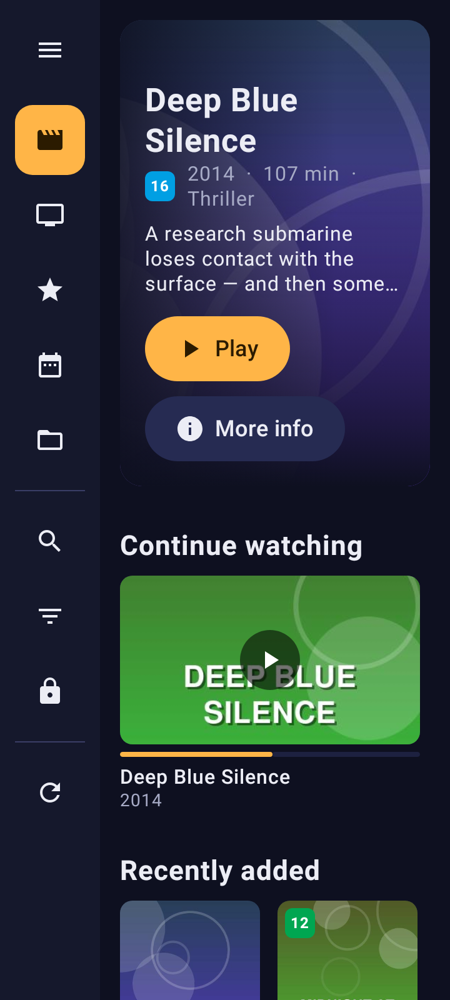
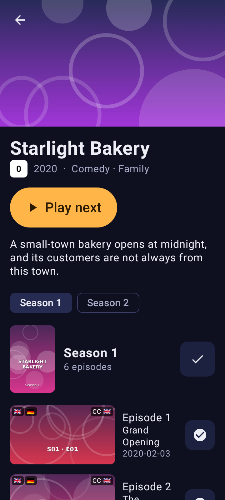
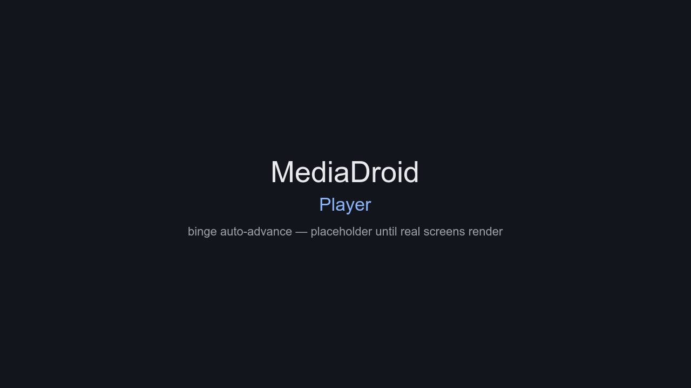
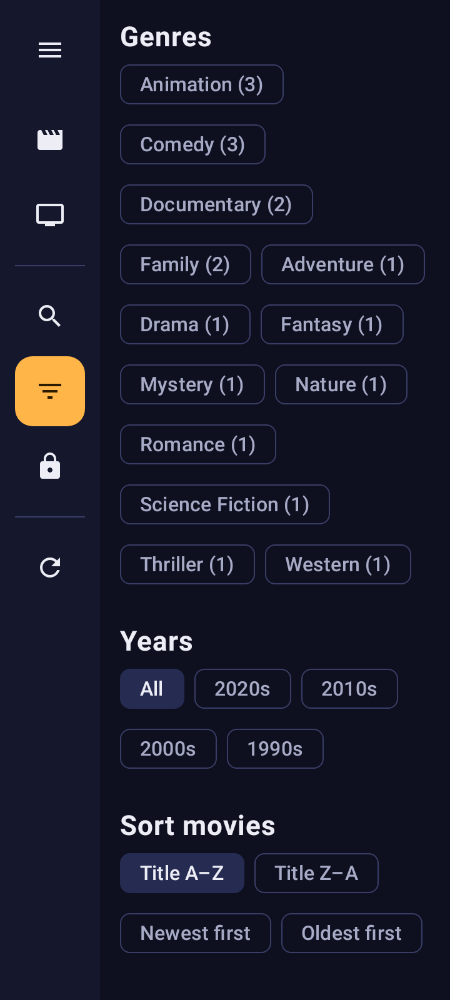

# MediaDroid

[](https://github.com/Hawkynt/MediaDroid/blob/main/LICENSE)
[](https://github.com/Hawkynt/MediaDroid)

[](https://github.com/Hawkynt/MediaDroid/actions/workflows/ci.yml)


[](https://github.com/Hawkynt/MediaDroid/stargazers)
[](https://github.com/Hawkynt/MediaDroid/network/members)
[](https://github.com/Hawkynt/MediaDroid/issues)


[](https://github.com/Hawkynt/MediaDroid/releases/latest)
[](https://github.com/Hawkynt/MediaDroid/releases)
[](https://github.com/Hawkynt/MediaDroid/releases)

> Your movies and shows are already organized — folders with `.nfo` files and cover art, scraped by Kodi or MediaBrowser over the years. MediaDroid plays that library straight from where it lives — local storage, a NAS share, an FTP server or a cloud folder — on any Android box, tablet, or phone: no media server, no account of ours, no re-scraping, no re-encoding. It reads what is already there and turns it into a browse-and-play app simple enough for a six-year-old and a grandparent.



## 🧭 Vision

Media libraries on Android are usually either a raw file browser or a client of someone else's server. MediaDroid claims the middle ground that home media collectors actually live in: the folders are the library, and the `.nfo` sidecars and `folder.jpg` covers you already scraped are the metadata — no database of ours in between. The bar for success is a household where nobody has to be taught the app: a kid finds a film by its picture, a grandparent resumes a show where they left off, and everything answers instantly even on cheap hardware. The parser, the scanner, the search and the binge logic are pure and tested; the screens sit on top of them and must never get slower than the hardware allows. The app scans a library, shows the wall, plays with resume and binge auto-advance, decodes exotic audio through a bundled FFmpeg extension, and paints missing art from the video files themselves.

## ✨ Features

- Reads `movie.nfo`, `tvshow.nfo`, and per-episode NFOs: plot, cast, runtime, rating, sets, trailer links.
- Covers from `folder.jpg` / `poster.jpg`, backdrops from `fanart.jpg`, logos and banners where present. A movie file's own `<name>.jpg` or `<name>-poster.jpg` is its poster; a season's cover is the `folder.jpg` in its folder or `seasonNN-poster.jpg` beside the show; episodes show their `<name>-thumb.jpg`.
- No art? The app pulls a still out of the video itself — episode thumbs and poster fallbacks, generated once and cached on device. A show without a cover or backdrop is pictured by the first episode of its first regular season (never the specials), a season without a cover by its first episode's thumb or a still from it — on the wall and on the details screen alike.
- Shows without `Season NN` folders are grouped into virtual seasons from `SxxExx` / `NxNN` file names; titles fall back to the folder and file names. Absolute numbering without seasons — `E3`, `E03`, `EP003`, common for anime — is season 1, and inside a `Season NN` folder a bare `E03` belongs to that season.
- Release clutter in movie and show names is stripped: `The.Big.Short.2015.German.DL.1080p.BluRay.x264-GRP` reads `The Big Short (2015)`. Episodes are labelled `Episode 3`; a title comes from the episode NFO, or from the file name only in the clean forms `S01E03 - Title`, `1x03 - Title`, `E03 - Title` or `EP003 - Title`. Anything else stays `Episode 3` — rename the file or add an NFO to give it a title. An NFO title always wins.
- Every video that is no episode is a movie, even without a year or an NFO (`Heat.mp4` is `Heat`); a folder holding one video is that movie, named after the folder. Trailers (`<name>-trailer.mkv`) and samples are skipped.
- Art in any picture format: JPEG, PNG, WebP, GIF, BMP, HEIC/HEIF and AVIF through Android's own decoders, TIFF (strips or tiles; LZW, Deflate or PackBits), TGA and PCX through the app's own — large scans are sampled down to the screen as they are read.
- Every container the player reads counts as a video: MP4 and QuickTime (`.mp4 .m4v .mov .qt .3gp .3g2 .f4v`), Matroska and WebM (`.mkv .mk3d .webm`), AVI (`.avi .divx .xvid`), MPEG program streams (`.mpg .mpeg .mpe .mp2 .m2p .vob`), MPEG transport streams (`.ts .m2ts .mts .m2t .tp .trp`), Ogg (`.ogv .ogm`) and Flash video (`.flv`).
- Multi-part movies (`CD1`/`CD2`, `part1`/`part2`, `disc a`/`disc b`, as Kodi stacks them) are one movie that plays its parts one after the other, with the folder's cover.
- From NFOs: genres, an age badge in the familiar rating colours, and flags for the audio and subtitle languages listed in the stream details.
- AC3, E-AC3, DTS, TrueHD and other exotic audio tracks play through a bundled FFmpeg decoder, even on hardware without them.
- Binge mode, on out of the box: when an episode ends, the next one starts — season by season, in order. Intros are jumped over (also those after a cold open) and an episode ends where its credits begin, when the file's own chapters (Matroska / WebM, MP4 / MOV — Nero or QuickTime — and Ogg) or an edit decision list beside it mark them — the Kodi / MPlayer `.edl` that Jellyfin's Intro Skipper, Comskip and friends write (`<video>.edl`: `start end action` per line; a cut, commercial break or intro edit near the start is the intro, the last one after it is where the credits begin). Both can be switched off in Settings.
- Episode previews carry what the file holds: audio-language flags, subtitle languages, and badges for resolution (480p … 2K, 4K, 8K), HDR (HDR10, HDR10+, Dolby Vision, HLG), the video format and the best audio (Dolby Digital/Digital+/TrueHD/Atmos, DTS/DTS-HD MA/DTS:X, …) with its channels. They are read out of the video itself once and cached; the NFO's stream details only stand in when a file cannot be read. File names are never trusted for it.
- Watched ticks: every movie, every episode and every whole season has one, and the wall marks a movie or a show once all of it is watched; tapping it marks watched or unwatched, and that choice wins over a playcount in the NFO.
- Resume: every item remembers where you stopped. Once only the last two minutes or the credits are left — played up to there or skipped forward into them — the item counts as watched. Play on a show carries on with the episode in progress or the first one not yet watched; Continue watching shows the season and episode and a bar of how much is watched.
- A sidebar on the left switches between Movies and TV Shows (plus Search, Filters and Settings); the content side shows only that selection. One tap collapses it to an icon rail and expands it again, and it remembers how you left it.
- The home of each section reads like the streaming apps everyone already knows: a backdrop hero for one title with Play and More info, a Continue watching row, then the poster wall. Works with touch, a mouse, or a TV remote's D-pad.
- The media folder is chosen with Android's own folder picker — internal storage, SD card or USB drive — with a typed path as the fallback for boxes that ship no picker.
- A title's details open with its backdrop across the top, never taller than 40 % of the screen, so the title, Play and the start of the plot are in view in portrait and landscape alike.
- No database: the folders are the library. It is re-read every time the app opens or comes back to the foreground, so a film copied onto the SD card is simply there. Watched marks and resume positions are the only things the app keeps. Coming back from a title's details lands at the same scroll position.
- Dark cinema theme and its own launcher icon, adaptive and themed-icon ready.
- Subtitles on/off with a preferred language, and a picker for every audio and subtitle track a file carries.
- Holding skip forward or back — on screen, or a remote's left/right and its rewind / fast-forward keys — steps 10 s, then 30 s after three seconds of holding, 60 s after six and five minutes after nine; the target time shows while holding and letting go seeks there once. A short tap stays the ordinary skip.
- Subtitles in the gear: a delay of −10 … +10 s in tenths of a second, four sizes, a raised position above burned-in text and an optional dark box behind the text. The household sets the look in the guarded settings; each video can keep its own look and delay.
- Sleep timer in the gear: off, 15, 30, 45, 60 or 90 minutes, or at the end of this video. While it runs the top bar shows the minutes left; when it runs out the sound fades over ten seconds and playback pauses. It never carries over to the next start.
- Repeat in the gear: off, this video, or all of it (the show or the folder, round again from the start) — for the film a child wants to see again and again. It lasts for the session.
- With the controls up, the bar also tells when the film will be over on the clock ("Ends 21:35", in the device's 12/24-hour format), allowing for the playback speed.
- The player shows nothing but the picture: a tap brings the controls up, a few seconds untouched fade them out, and the status and navigation bars stay hidden while watching.
- Video plays on the device's own hardware decoders; the bundled FFmpeg decoder only steps in for what they cannot play. Settings can put software decoding first, with a warning: it drains the battery fast and is meant for videos that otherwise do not play at all or only with errors.
- The player's gear holds playback speed from 0.2× to 5× (starting at the default speed), subtitles and track pickers, and brightness/gamma/contrast/color for the video on screen — remembered per video, live as you drag, and the picture size: Fit, Fill (crop to the screen) or Stretch.
- Touch on the bare picture: double tap left or right jumps 15 s back or ahead, a vertical swipe on the left half sets the screen brightness and on the right half the volume — both run on past the device's maximum up to 800 %, doubling every third of the extra stretch: louder through the app's loudness gain (soft-saturating, so quiet tracks come up without cracking peaks), brighter through a gamma lift — and a pinch zooms up to 4× and pans the zoomed picture.
- Next and Previous on the controls move through the episodes or the parts of a movie; Previous restarts the current one when it is more than 3 s in.
- Turning the device keeps the player going: same video, same position, same open panel.
- While the phone's own screen is mirrored to a TV (Smart View and the like), the player keeps its bars and the gear panel inside the centred 16:9 part a TV shows, so nothing is cut off.
- With a second screen attached (HDMI, a USB-C dock, a wireless display) a button sends the video alone there; the phone keeps the controls.
- Parent-guarded settings behind a four-digit PIN, freshly drawn on every visit and shown on screen as words — a child who cannot read cannot get in, and nobody has to remember anything. There: default speed, loudness boost for unnormalized audio, the default brightness/gamma/contrast/color every video starts from, subtitle and stream languages, and a maximum-age mode that hides content whose NFO certification is too old (FSK, MPAA and TV ratings understood).
- Instant search across the whole library.
- Filter by genre and year, group by decade, facet counts as you browse.
- Big touch targets and high contrast — usable by kids and older users without glasses-or-guessing.
- Local libraries work fully offline. No account of ours and no telemetry; a network share or cloud is contacted only once you add it as a source, with the credentials you give it, kept in the device's keystore.

## 🧩 Support matrix

| Source | Read | Write | Notes | Reference |
| --- | :---: | :---: | --- | --- |
| [Movie NFO](https://kodi.wiki/view/NFO_files/Movies) | ✅ | — | Title, plot, runtime, year, genres, set, cast, IDs | [Kodi NFO docs](https://kodi.wiki/view/NFO_files) |
| [TV show NFO](https://kodi.wiki/view/NFO_files/TV_shows) | ✅ | — | `tvshow.nfo` per show folder | [Kodi NFO docs](https://kodi.wiki/view/NFO_files) |
| Episode NFO | ✅ | — | Named after its video file; season/episode may also come from the name | [Kodi NFO docs](https://kodi.wiki/view/NFO_files) |
| NFO stream details | ✅ | — | `<fileinfo><streamdetails>` audio and subtitle languages (3-letter codes) shown as flags | [Kodi NFO docs](https://kodi.wiki/view/NFO_files/Movies) |
| Multi-part movies | ✅ | — | Kodi's default `cd`/`dvd`/`part`/`pt`/`disk`/`disc` + number or a–d stacking | [Kodi advancedsettings.xml](https://kodi.wiki/view/Advancedsettings.xml#moviestacking) |
| `SxxExx` / `NxNN` file names | ✅ | — | The prevailing rip and scraper naming | — |
| Art: `folder.jpg`, `poster.jpg`, `fanart.jpg`, banner, clearlogo, discart | ✅ | — | Numbered variants (`poster-1.jpg`) count | [Kodi art conventions](https://kodi.wiki/view/Artwork) |
| Containers & codecs | ✅ | — | Video on the device's own decoders (MP4/MKV, H.264, HEVC/AV1 per device); audio falls back to a bundled FFmpeg decoder for AC3, E-AC3, DTS, TrueHD, MLP, ALAC, Vorbis and more | [Media3 FFmpeg extension](https://github.com/androidx/media/tree/release_v1.11.1/libraries/decoder_ffmpeg), [Android formats](https://developer.android.com/guide/topics/media/media-formats) |

`✅` full · `⚠️` partial, explained in the row · `—` unsupported.

## 📦 Installation

Android 8.0 (API 26) or newer, phone, tablet, or TV box. Not on the Play Store (yet): download the APK from [Releases](https://github.com/Hawkynt/MediaDroid/releases) — a dated stable build or a `nightly-*` build. Take `MediaDroid.apk`, the signed release build, and enable installation from unknown sources; `MediaDroid-debug.apk` is for development and cannot update over it. Storage stays on your device; the app needs access only to the folders you point it at.

## 🚀 Quick start

```bash
adb install MediaDroid.apk
```

Open MediaDroid, grant file access, tap **Choose media folder** and pick the root of your media folders in the system folder picker: the library is read, the sidebar opens on Movies, and the wall fills with covers, and plots, seasons and episode thumbs come from the `.nfo` files already sitting there. Tapping a show offers Play next — episodes run in order and mark themselves watched.

## 🖼️ Screenshots

Generated documentation: every push to a working branch renders the real screens on the JVM
(Robolectric + Roborazzi) from a demo library of invented titles whose posters, backdrops and episode
thumbs are painted from the titles themselves, and commits whatever changed back onto the branch. Run
`./gradlew :app:recordRoborazziDebug -Pscreenshots` to render them locally.





## 🗺️ Roadmap

### Player

Specified, not built yet. Prior art: [Nova Video Player](https://github.com/nova-video-player/aos-Video) (Apache-2.0), looked at as a user would and read for its menus; only what fits a household player without accounts or a network made it here.

- **Child lock.** A lock in the gear freezes the player: every touch and swipe is ignored, a small lock symbol shows briefly on any touch, and only holding that symbol for two seconds unlocks. Volume keys keep working.
- **Night mode.** A switch in the gear compresses the dynamic range in the app's audio stage: quiet dialogue comes up, explosions come down, for late evenings and thin walls. It combines with the loudness gain and the volume boost.
- **Audio delay.** In the gear, −2.5 s … +2.5 s in 50 ms steps to fix lip-sync; remembered per audio output (the phone's speaker, each Bluetooth headset, HDMI), since each has its own latency.
- **Title from the file.** Without an NFO title, the title the container itself carries (Matroska / MP4 metadata) comes before the cleaned-up file or folder name.
- **Display cutout.** In Fill mode the picture may extend into the camera notch / punch hole, as a switch next to the picture sizes.
- **Spatial audio.** On Android 13+ a switch in the gear hands multichannel sound to the platform spatializer for headphones that support it.
- **Picture in picture.** Leaving the app while a video plays keeps it running in a small window; returning brings the full player back where it was.
- **Media controls everywhere.** A media session puts play/pause, next and previous on the lock screen, in the notification and on headset and Bluetooth buttons.
- **What is playing.** An info sheet in the player lists the file, container, every video/audio/subtitle track with codec, language and channels, resolution and frame rate, and which decoder is at work (hardware or software).
- **On TV boxes.** Optional switching of the display refresh rate to the film's frame rate (no judder at 23.976 fps), and an audio-passthrough option that hands AC3/E-AC3/DTS/TrueHD untouched to an AV receiver over HDMI.
- **Rotation.** Auto, landscape or portrait, held for the session, from the gear.

### Navigation and browsing

From the same look at Nova's library side: what it browses, what an item tells about itself, and where.

- **More rows on each home.** Under Continue watching: *Recently added* (by the file's date on disk, newest first), *Not watched yet* and, for shows, *New episodes* (shows whose newest episode is unwatched, newest first). Each row scrolls sideways and ends in a "See all" that opens the full wall in that order.
- **Resume from anywhere.** The bottom of the sidebar menu shows the last thing played — its picture, title, how far in, and a play button — so a single tap resumes it from any screen; collapsed, it is a single play button with the picture behind it.
- **Sort orders.** Next to A–Z, Z–A, newest and oldest: *recently added*, *runtime* (shortest / longest first) and, where NFOs carry it, *rating*. Shows add *recently updated* (newest episode first). The choice is remembered per section.
- **Display modes.** Posters (today's wall), a compact list (thumbnail, title, year, runtime, badges) and a details list that adds two lines of plot — for remotes and for libraries too big to scan by pictures.
- **Jump by letter.** Long libraries get an A–Z rail along the edge of the wall; dragging along it jumps to the letter, the letter shows big while dragging.
- **Browse by genre and year as places.** Besides the filter chips, Genres and Years are entries in the sidebar that open a list of genres / decades with counts and a poster collage each, leading to the wall for one of them.
- **Files.** A Files entry in the sidebar browses storage as it really is, like a file manager: the device's internal storage, the SD card, USB drives and every saved network or cloud source — not only the media library. The structure is never reinterpreted: folders and files keep their real names when nothing better is known (no release-name clean-up), and nothing is grouped into movies, shows or seasons. What sits beside them is respected, though: a video's NFO gives it its title, plot, age badge and watched state, and the usual art shows — `folder.jpg` / `poster.*` as a folder's cover, `<name>.jpg`, `<name>-poster.*` or `<name>-thumb.*` for a video — falling back to a frame from the video. Folders come first, then videos with their picture, duration and badges, sorted by name, date or size. Tapping a video plays it in the same player with resume; binge mode simply goes on to the next video in the same folder in that order, and Play on a folder starts with its first.
- **One title, several files.** The same film twice (1080p and 4K, a German and an English cut) is one card with a small count; its details list every file with resolution, HDR, audio and language badges and size, and Play takes the one last played, else the best picture.
- **What a card shows.** Every poster and list item carries its resume bar (not only in Continue watching), the watched tick, and — in list mode — runtime and the quality badges the episode rows already have.
- **Details.** Adds, where the NFO has them, rating, director, studio and the premiered date; a *Trailer* button when a `<name>-trailer.*` sits beside the film (trailers stay off the wall); and a collapsible *File* section with the path, size, container, every video / audio / subtitle track and which decoder plays it.

Considered and left out: online scraping, playlists, and IMDb/TMDb links — the metadata stays what is already in the folders.

### Sources

The library may live anywhere a household keeps its folders. Every source below is browsed like the SD card is today, and can be the media root (or one of several roots) the scanner reads, with the same NFO and art conventions.

- **Several roots.** Settings list any number of media roots, each local or remote, each with its own name; the walls merge them, and a title found on two roots is one card with two files (see *One title, several files*).
- **Windows / Samba shares (SMB 2/3).** Server, share, user and password (or guest); servers on the local network are discovered and offered.
- **NFS shares.** Server and export path, for NAS boxes that serve Linux clients.
- **FTP, FTPS and SFTP.** Host, port, user and password or an SSH key; passive mode for FTP.
- **WebDAV.** URL, user and password — Nextcloud, ownCloud and most NAS web shares.
- **Online clouds.** Google Drive, OneDrive, Dropbox, Nextcloud and anything else that installs an Android document provider, picked in the system's own picker like a local folder; the app itself stores no cloud passwords.
- **Saved connections.** Each source is saved once with a name; passwords and keys live in the Android Keystore, never in the state file. A source that is unreachable stays on the walls greyed out with "not reachable right now" instead of vanishing.
- **Reading a remote library.** The scan of a remote root runs in the background and keeps its result (titles, NFO contents, art) cached on the device, so the wall appears instantly and offline; art is downloaded once and kept small. A rescan picks up changes by size and modification time.
- **Playing from the network.** Remote videos stream with enough buffer for 4K over Wi-Fi; resume, binge, intro/credits skip, badges and thumbnails work as for local files, and frames and badges are probed once and cached.

## 🛠️ Building

Requires JDK 21 and an Android SDK with platform 37; `local.properties` must point `sdk.dir` at it.

```bash
./gradlew assembleDebug   # app/build/outputs/apk/debug/app-debug.apk
./gradlew test            # parser, library, and binge-logic unit tests
```

## 🤝 Contributing

See [CONTRIBUTING.md](CONTRIBUTING.md) — commit messages carry `+ - * # !` prefixes because the changelog is generated from them, and pull requests run the full gate.

## 🆘 Getting Help

[Open an issue](https://github.com/Hawkynt/MediaDroid/issues): say which device and Android version, what you pointed the app at, and what you expected instead. Library-parsing bugs should name the folder layout.

## ❤️ Support

If this project saves you time or money, consider supporting its development:

[](https://github.com/sponsors/Hawkynt)
[](https://www.paypal.me/hawkynt)

## 📜 License

Licensed under LGPL-3.0-or-later — see [LICENSE](LICENSE).
